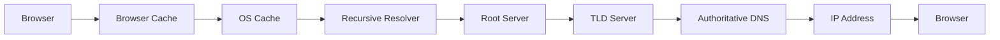
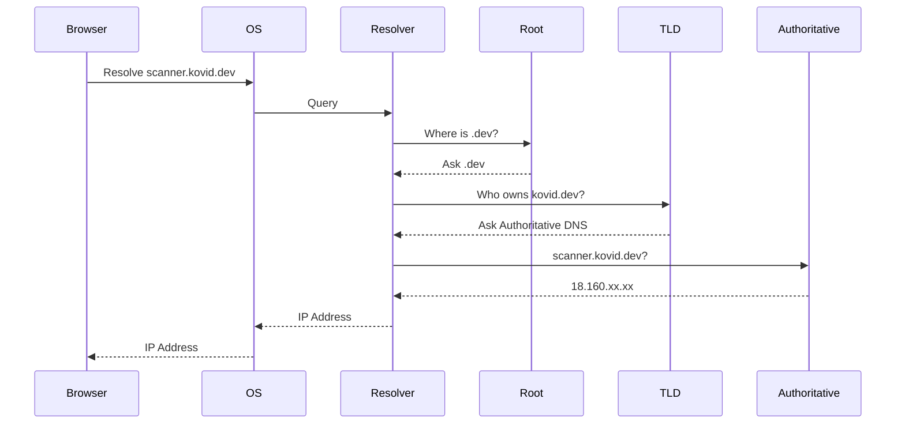

# DNS Resolution

> *DNS answers one simple question: "Where is this server?"*

---

# The Goal

Suppose a user enters

```text
https://scanner.kovid.dev
```

The browser cannot connect using the name.

It first needs an IP address.

The entire DNS resolution process exists to answer:

```
scanner.kovid.dev

↓

18.160.xx.xx
```

Only after obtaining the IP address can TCP begin establishing a connection.

---

# High-Level Flow



---

# Step 1 — Browser Cache

The browser first checks whether it has already resolved this domain recently.

Example

```
github.com

↓

140.82.xx.xx
```

If the cached entry is still valid (TTL not expired), DNS resolution stops here.

No network request is made.

---

# Step 2 — Operating System Cache

If the browser cache misses,

the operating system checks its own DNS cache.

Every application on the computer shares this cache.

Windows

```powershell
ipconfig /displaydns
```

Linux

```bash
resolvectl statistics
```

If found,

the operating system immediately returns the IP.

---

# Step 3 — Recursive Resolver

If neither cache contains the answer,

the operating system asks its configured DNS resolver.

Examples:

```
8.8.8.8

1.1.1.1

9.9.9.9

ISP DNS
```

This resolver performs all the remaining work.

Think of it as your assistant.

You ask one question.

It finds the answer.

---

# Step 4 — Root Name Server

If the recursive resolver has never seen the domain before,

it asks a Root Server.

The Root Server **does not know the IP address**.

It only knows who manages each Top-Level Domain.

Example

```
Where is .dev?

↓

Ask the .dev servers.
```

---

# Step 5 — Top-Level Domain (TLD) Server

The resolver now contacts the `.dev` TLD server.

Question

```
Who manages kovid.dev?
```

The TLD server replies

```
Ask these authoritative servers.
```

Still no IP address.

---

# Step 6 — Authoritative Name Server

Finally,

the recursive resolver reaches the authoritative DNS server.

This server owns the DNS zone for

```
kovid.dev
```

It responds with

```
scanner.kovid.dev

↓

18.160.xx.xx
```

Mission accomplished.

---

# Step 7 — Cache Everything

The answer is cached by:

- Browser
- Operating System
- Recursive Resolver

Future requests become much faster.

---

# Complete Sequence



---

# Recursive vs Iterative Queries

This is one of the most important interview questions.

## Recursive Query

The client asks

```
Find the answer for me.
```

The recursive resolver performs every lookup.

Example

```
Browser

↓

Resolver

↓

Internet
```

The browser waits.

---

## Iterative Query

The DNS server replies

```
I don't know,

but ask this server.
```

The client (or resolver) continues asking other servers.

Root and TLD servers typically respond this way.

---

# Mental Model

Imagine asking for a friend's address.

You ask your assistant.

Your assistant asks:

- City Hall
- Neighborhood Office
- Apartment Manager

Eventually,

your assistant returns with the exact address.

You only asked one person.

That person did the work.

That's recursive DNS.

---

# Common Misconceptions

### DNS does NOT connect you to the server.

It only provides the IP address.

---

### Root Servers do NOT know every IP.

They only know where the next DNS server is.

---

### Authoritative Servers own the truth.

Only they can provide the official DNS records for a domain.

---

# Real World Example

Suppose your Vulnerability Scanner is deployed on AWS.

```
scanner.kovid.dev

↓

Route53

↓

18.160.xx.xx
```

The browser never knows AWS.

It simply asks DNS.

DNS replies with an IP.

The browser then moves to TCP.

---

# Practical

Run

```bash
dig github.com
```

Observe:

- QUESTION SECTION
- ANSWER SECTION
- AUTHORITY SECTION
- ADDITIONAL SECTION

Now run

```bash
dig +trace github.com
```

Watch every DNS server participate in the resolution.

---

# Key Takeaways

- DNS resolution begins with local caches.
- Recursive resolvers perform the lookup.
- Root servers know TLD servers.
- TLD servers know authoritative servers.
- Authoritative servers provide the final answer.
- Every successful lookup is cached.
- DNS only returns an IP address—it does not establish a connection.

---

# Next

➡ **03-Records.md**