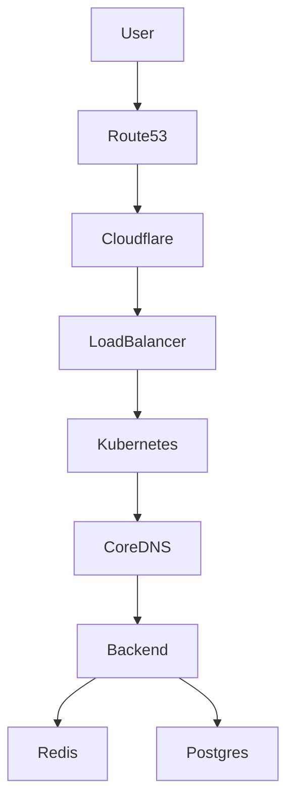

# Production DNS

> *Modern DNS is no longer just "Name → IP". It has become a global traffic management system.*

---

# Why Production DNS Exists

Imagine Google had only one server.

```
google.com

↓

California
```

Now imagine someone from India opens Google.

Every request travels halfway around the world.

Slow.

Expensive.

Not scalable.

Modern DNS solves this.

---

# Modern DNS

Instead of returning one IP,

DNS may return different answers depending on

- User Location
- Latency
- Server Health
- Server Load
- Routing Policies

```
google.com

↓

India

↓

142.xx.xx.11

USA

↓

142.xx.xx.22

Japan

↓

142.xx.xx.33
```

Same domain.

Different answers.

---

# GeoDNS

GeoDNS returns answers based on geographical location.

```
India

↓

Mumbai

Germany

↓

Frankfurt

Japan

↓

Tokyo
```

Nearest server.

Lower latency.

---

## Used By

- Netflix
- Google
- Cloudflare
- AWS

---

# Latency-Based Routing

Nearest isn't always fastest.

Suppose

Mumbai Server

is overloaded.

Latency becomes

```
Mumbai

↓

140 ms

Singapore

↓

70 ms
```

DNS returns

Singapore

instead.

Fastest server wins.

---

# Weighted Routing

Imagine you're deploying

Version 2

of your application.

You don't want everyone using it.

Instead

```
90%

↓

Version 1

10%

↓

Version 2
```

Gradually increase

```
20%

↓

50%

↓

100%
```

This is called

**Canary Deployment**.

---

# Failover Routing

Imagine

```
Mumbai

↓

Offline
```

Health Check fails.

DNS automatically replies

```
Singapore
```

Users continue using the application.

No manual intervention.

---

# Health Checks

Cloud DNS providers constantly check

- HTTP
- HTTPS
- TCP

If a server becomes unhealthy,

DNS stops returning that IP.

---

# Anycast

One of the coolest networking concepts.

Imagine

```
1.1.1.1
```

Looks like

one server.

Reality

```
India

↓

Mumbai

USA

↓

New York

Germany

↓

Frankfurt

Australia

↓

Sydney
```

Every server shares

```
1.1.1.1
```

Internet routing automatically sends users to the nearest instance.

---

# Why Root DNS Never Fails

People often hear

> "There are only 13 Root DNS servers."

Technically,

there are 13 **logical** root server identities.

Each is replicated across hundreds of physical servers worldwide using **Anycast**.

This is one reason the global DNS infrastructure is highly resilient.

---

# AWS Route 53

Route 53 is AWS's managed DNS service.

It provides

- Domain Registration
- DNS Hosting
- Health Checks
- Traffic Routing
- Failover
- GeoDNS
- Latency Routing

---

# Route53 Architecture

```text
User

↓

Route53

↓

Application Load Balancer

↓

EC2

↓

Docker

↓

Fastify
```

Notice

Route53

doesn't care

what application runs.

It simply directs users to the correct endpoint.

---

# Alias Records

AWS introduced

Alias Records.

Looks similar to

```
A Record
```

but instead of storing an IP,

it can point directly to

- CloudFront
- Application Load Balancer
- API Gateway
- S3 Website
- Elastic Beanstalk

No IP address required.

---

# Cloudflare DNS

Cloudflare combines

```
DNS

↓

CDN

↓

Caching

↓

WAF

↓

DDoS Protection
```

One DNS query can automatically route traffic through Cloudflare's global edge network before reaching your origin server.

---

# Kubernetes CoreDNS

Imagine your cluster contains

```
Frontend

Backend

Redis

Postgres
```

Pods change frequently.

IPs are temporary.

Instead of remembering

```
10.244.5.12
```

Applications use

```
redis.default.svc.cluster.local
```

CoreDNS resolves this name to the current Redis Pod.

Applications don't need to know the changing IP addresses.

---

# Internal DNS

Large companies use private DNS zones.

Example

```
db.internal

↓

10.0.3.20

payments.internal

↓

10.0.5.14

auth.internal

↓

10.0.2.8
```

These names never appear on the public Internet.

---

# Service Discovery

In a microservice architecture,

DNS becomes the service directory.

```
Frontend

↓

users.internal

↓

payments.internal

↓

orders.internal

↓

redis.internal
```

Applications communicate using names,

not IP addresses.

---

# Real World Architecture



---

# Production Example

Imagine your Vulnerability Scanner.

```
scanner.kovid.dev

↓

Cloudflare DNS

↓

AWS Route53

↓

Load Balancer

↓

Docker

↓

Fastify

↓

PostgreSQL
```

If tomorrow

you migrate

from Mumbai

to Singapore,

users continue visiting

```
scanner.kovid.dev
```

Only the DNS configuration changes.

---

# Engineering Insight

DNS is one of the first systems that participates in scaling an application.

Before your application receives a request,

DNS has already decided

- Which region
- Which data center
- Which server

should handle the user.

---

# Where You'll Use This

## Developer

- Custom domains
- Cloudflare
- AWS Route53
- HTTPS setup

## DevOps

- High Availability
- Disaster Recovery
- Blue-Green Deployment
- Canary Deployment

## Cloud

- Multi-region architecture
- Global load balancing
- Service discovery

## Kubernetes

- CoreDNS
- Internal Services
- Cluster Networking

## Interview

- What is Anycast?
- Difference between GeoDNS and Anycast?
- What is Route53?
- Why do companies use latency routing?
- Why are internal DNS names important?

---

# Key Takeaways

- Production DNS routes users intelligently.
- GeoDNS returns location-based answers.
- Latency routing chooses the fastest healthy server.
- Weighted routing supports gradual deployments.
- Failover routing improves availability.
- Anycast provides global resilience.
- CoreDNS enables Kubernetes service discovery.
- Route53 manages DNS in AWS.

---

# Next

➡ **06-Security.md**