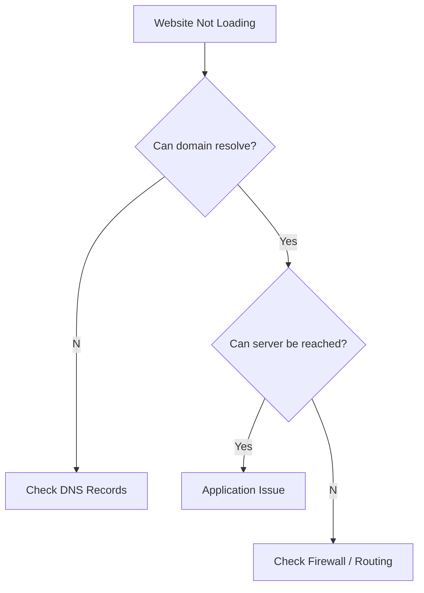

# DNS Debugging & Labs

> *Knowing DNS is theory. Debugging DNS is engineering.*

---

# DNS Troubleshooting Flow



---

# Essential Commands

## Windows

```powershell
nslookup github.com

Resolve-DnsName github.com

ipconfig /displaydns

ipconfig /flushdns

tracert github.com
```

---

## Linux

```bash
dig github.com

dig +trace github.com

host github.com

cat /etc/resolv.conf

traceroute github.com
```

---

# What Every Tool Does

| Tool | Purpose |
|-------|----------|
| dig | Detailed DNS lookup |
| nslookup | Basic lookup |
| host | Simple DNS query |
| Resolve-DnsName | Windows DNS tool |
| traceroute | Network path |
| Wireshark | Packet capture |

---

# Common Problems

## NXDOMAIN

Meaning

```
Domain doesn't exist.
```

Usually

- Typo
- Wrong DNS record
- Wrong domain

---

## SERVFAIL

Meaning

```
DNS server failed.
```

Possible causes

- Broken authoritative server
- DNSSEC issue
- Upstream resolver failure

---

## Timeout

Usually

- Firewall
- Resolver unreachable
- Network issue

---

## Wrong IP

Possible causes

- Cache
- TTL not expired
- Wrong A record

---

# Practical Labs

## Lab 1

Resolve a website.

```bash
dig github.com
```

Observe

- TTL
- IP
- Record Type

---

## Lab 2

Trace DNS resolution.

```bash
dig +trace github.com
```

Watch

```
Root

↓

TLD

↓

Authoritative
```

---

## Lab 3

Inspect DNS cache.

Windows

```powershell
ipconfig /displaydns
```

Linux

```bash
resolvectl statistics
```

---

## Lab 4

Flush DNS cache.

Windows

```powershell
ipconfig /flushdns
```

Linux

```bash
sudo resolvectl flush-caches
```

Repeat

```
dig github.com
```

Notice the fresh lookup.

---

## Lab 5

Capture DNS packets.

Open Wireshark.

Filter

```
dns
```

Then

```
Visit github.com
```

Observe

- Query
- Response
- TTL
- Transaction ID

---

# Mini Project

Create your own DNS infrastructure on AWS.

Example

```
Route53

↓

scanner.kovid.dev

↓

Application Load Balancer

↓

EC2

↓

Docker

↓

Fastify
```

Then

- Add HTTPS
- Configure CAA
- Configure SPF
- Configure DKIM

Congratulations.

You've configured production DNS.

---

# Real World Debugging

Suppose

```
scanner.kovid.dev

↓

Not Working
```

Checklist

```
✓ Domain Registered?

↓

✓ NS Correct?

↓

✓ A Record Exists?

↓

✓ TTL Expired?

↓

✓ DNS Cache?

↓

✓ Server Running?

↓

✓ Firewall?

↓

✓ Application?
```

Never guess.

Always debug layer by layer.

---

# Interview Questions

### Easy

- What is DNS?
- Why was DNS invented?
- What is TTL?
- What is an A Record?

---

### Medium

- Difference between Recursive and Authoritative DNS?
- Difference between CNAME and A?
- Difference between GeoDNS and Anycast?

---

### Advanced

- Explain complete DNS resolution.
- How does Route53 perform failover?
- Why is DNSSEC important?
- How does Kubernetes use DNS?

---

# Skills Checklist

After finishing this chapter you should be able to

- [ ] Explain why DNS exists
- [ ] Explain recursive resolution
- [ ] Identify major DNS records
- [ ] Configure Route53
- [ ] Configure Cloudflare DNS
- [ ] Explain CoreDNS
- [ ] Debug DNS failures
- [ ] Use dig confidently
- [ ] Capture DNS packets
- [ ] Explain DNSSEC

---

# Beyond This Chapter

## RFCs

- RFC 1034
- RFC 1035
- RFC 4033 (DNSSEC)

## Official Documentation

- Cloudflare DNS
- AWS Route53
- CoreDNS

## Related Topics

```
DNS

↓

TCP

↓

TLS

↓

HTTP

↓

Web Servers
```

---

# Chapter Complete ✅

You now understand

- Why DNS exists
- How DNS works
- How cloud providers use DNS
- How DNS is secured
- How engineers debug DNS

You are now ready for the next protocol.

➡ **NET-002 — TCP**