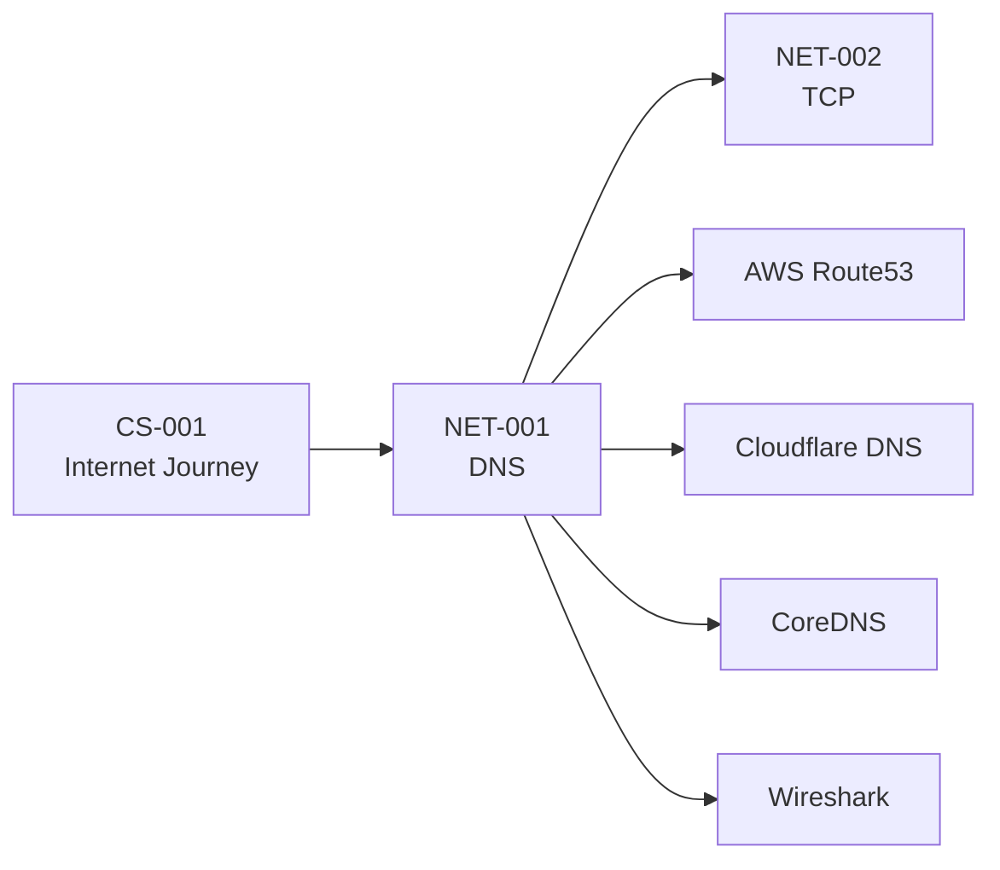

# NET-001 — Domain Name System (DNS)

> *"The Internet speaks numbers. Humans speak names. DNS translates between the two."*

---

# Overview

The **Domain Name System (DNS)** is one of the most important protocols on the Internet. Every time you open a website, send an email, or connect to an online service, DNS is usually the very first network protocol involved.

Without DNS, users would need to remember numerical IP addresses for every service they use.

Instead of remembering:

```text
142.250.183.78
```

we simply type

```text
google.com
```

DNS performs the translation.

---

# Why Learn DNS?

DNS is much more than "domain name → IP".

Understanding DNS explains:

- Why websites become reachable
- How browsers locate servers
- How cloud platforms route traffic
- How Kubernetes discovers services
- Why CDN routing works
- Why websites sometimes become unreachable
- Why DNS outages affect the entire Internet

DNS appears everywhere.

---

# Learning Objectives

After completing this chapter you should be able to:

- Explain why DNS was invented.
- Describe why HOSTS.TXT failed.
- Explain the DNS hierarchy.
- Understand recursive DNS resolution.
- Differentiate between Recursive, Root, TLD and Authoritative servers.
- Understand common DNS record types.
- Explain DNS caching.
- Explain TTL.
- Understand production DNS architecture.
- Understand Route53.
- Understand Cloudflare DNS.
- Understand Kubernetes CoreDNS.
- Explain common DNS security concepts.
- Debug common DNS problems.
- Capture DNS packets using Wireshark.

---

# Chapter Structure

| Part | Topic |
|-------|------|
| 01 | History & Why DNS Exists |
| 02 | DNS Resolution Process |
| 03 | DNS Records |
| 04 | Caching & TTL |
| 05 | Production DNS |
| 06 | DNS Security |
| 07 | Debugging & Practical Labs |

---

# Mental Model

Imagine the entire world.

Humans remember

```
221B Baker Street
```

Computers remember

```
51.52372
```

DNS is simply the Internet's address book.

It converts

```
Name

↓

Address
```

Nothing more.

Nothing less.

---

# Where DNS Fits

Before learning DNS, it is important to understand where it appears during a web request.


DNS only answers one question:

> **"Where is the server?"**

Everything after that belongs to later chapters.

---

# Real-World Usage

DNS is used by almost every modern system.

Examples include:

- Google Search
- GitHub
- AWS Route53
- Cloudflare DNS
- Kubernetes CoreDNS
- Microsoft Azure DNS
- Email Servers
- CDNs
- Load Balancers
- Reverse Proxies

---

# Why DNS Matters for Software Engineers

As a software engineer you'll encounter DNS when:

- Deploying applications
- Configuring domains
- Setting up HTTPS
- Using Cloudflare
- Deploying on AWS
- Building Kubernetes clusters
- Configuring API Gateways
- Troubleshooting production outages

DNS is not only a networking topic.

It is part of backend engineering, DevOps, cloud computing, and cybersecurity.

---

# Why DNS Matters for Cybersecurity

Attackers and defenders both rely on DNS.

Security professionals use DNS to:

- Analyze infrastructure
- Discover subdomains
- Investigate phishing
- Detect malware communication
- Validate email security
- Investigate incidents

A secure DNS configuration is a critical part of modern infrastructure.

---

# Practical Skills You'll Learn

By the end of this chapter you'll be comfortable using:

- dig
- nslookup
- host
- Resolve-DnsName
- traceroute
- Wireshark
- Cloudflare DNS
- Route53
- CoreDNS

---

# Related Technologies

DNS connects directly with:

```text
Internet

↓

DNS

↓

TCP

↓

TLS

↓

HTTP

↓

Load Balancer

↓

Reverse Proxy

↓

Fastify

↓

Database
```

It also connects with

- Route53
- Cloudflare
- Kubernetes
- Docker Networking
- Linux Resolver
- Nginx
- CDN

---

# Chapter Progress

- [ ] 01 History & Need
- [ ] 02 DNS Resolution
- [ ] 03 DNS Records
- [ ] 04 Caching & TTL
- [ ] 05 Production DNS
- [ ] 06 Security
- [ ] 07 Debugging & Labs

---

# Prerequisites

- CS-001 — How the Internet Reaches Your Program

---

# Unlocks

After completing DNS you are ready to understand:

- NET-002 — TCP
- HTTP
- TLS
- AWS Route53
- Kubernetes CoreDNS
- Cloudflare DNS
- Reverse Proxies
- Load Balancers

---

# Knowledge Graph



---

# Final Thought

DNS is often introduced as a simple protocol that converts names into IP addresses.

In reality, it is one of the largest distributed databases ever built and forms the foundation of modern cloud infrastructure.

Without DNS, the Internet would still function—but it would be nearly impossible for humans to use at today's scale.

---

## Next Section

➡ **01-History.md**