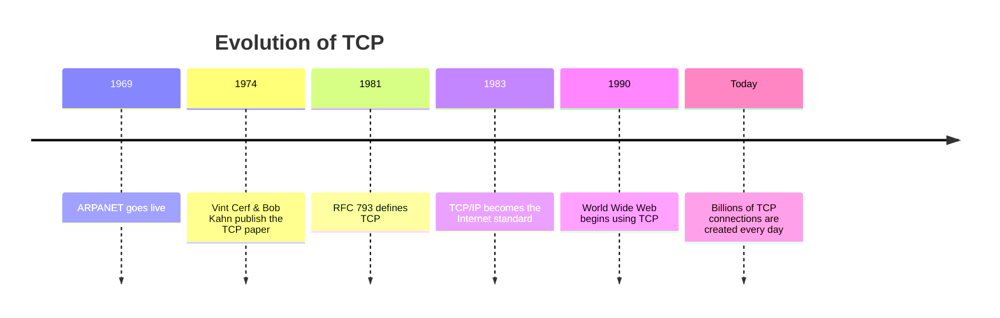

# History & Why TCP Exists

> *Every protocol exists because the previous solution had limitations.*

---

# The Problem

Early computer networks could send packets between machines.

However, the network made **no promises**.

A packet might:

- Arrive successfully
- Arrive twice
- Arrive out of order
- Be delayed
- Never arrive

For many applications, this was unacceptable.

Imagine downloading

```
ABCDEFGHIJ
```

and receiving

```
ABEFIJCDGH
```

or

```
ABCDGHIJ
```

Applications needed a way to communicate **reliably**, even when the underlying network was unreliable.

---

# Before TCP

ARPANET introduced packet switching, where messages were divided into smaller packets before transmission.

Packet switching improved efficiency, but it did **not** guarantee:

- Delivery
- Ordering
- Error recovery

Every application would have needed to solve these problems independently.

Engineers wanted one reusable solution.

---

# Birth of TCP

In **1974**, **Vint Cerf** and **Bob Kahn** proposed the **Transmission Control Protocol (TCP)**.

Instead of requiring every application to implement reliability, TCP handled it once at the transport layer.

Applications could simply send and receive data while TCP managed:

- Connection establishment
- Reliability
- Ordering
- Retransmissions
- Flow Control
- Congestion Control

---

# Timeline



---

# Why TCP Was Revolutionary

TCP transformed an unreliable packet network into a reliable byte stream.

Applications no longer needed to worry about:

- Lost packets
- Duplicate packets
- Out-of-order packets

TCP solved these problems once, allowing every application to benefit.

---

# Engineering Insight

TCP does **not** make the network reliable.

The network is still unreliable.

Instead, TCP detects problems and recovers from them, creating the illusion of a reliable connection for applications.

---

# Mental Model

```
Application

↓

Reliable Byte Stream

↓

TCP

↓

Unreliable Packet Network

↓

IP
```

Applications experience a reliable stream of bytes even though the underlying IP network only transports independent packets.

---

# Summary

- IP delivers packets without guarantees.
- Packet switching improved efficiency but not reliability.
- TCP was proposed by Vint Cerf and Bob Kahn in 1974.
- TCP adds reliability above IP.
- Modern Internet applications depend on TCP for dependable communication.

---

# Where You'll Use This

## Developer

- Understanding sockets
- Backend APIs
- Database connections

## DevOps

- Service communication
- Load balancing
- Reverse proxies

## Cybersecurity

- Packet analysis
- Network forensics
- Traffic inspection

## Interview

- Why was TCP invented?
- Why isn't IP enough?
- Who created TCP?

---

# Common Mistakes

❌ Thinking TCP makes the physical network reliable.

❌ Believing TCP replaces IP.

❌ Assuming applications communicate directly with IP.

---

# Related Topics

- NET-001 — DNS
- NET-002.2 — Connection Establishment
- NET-003 — TLS

---

# Next

➡ **02-Connection.md**