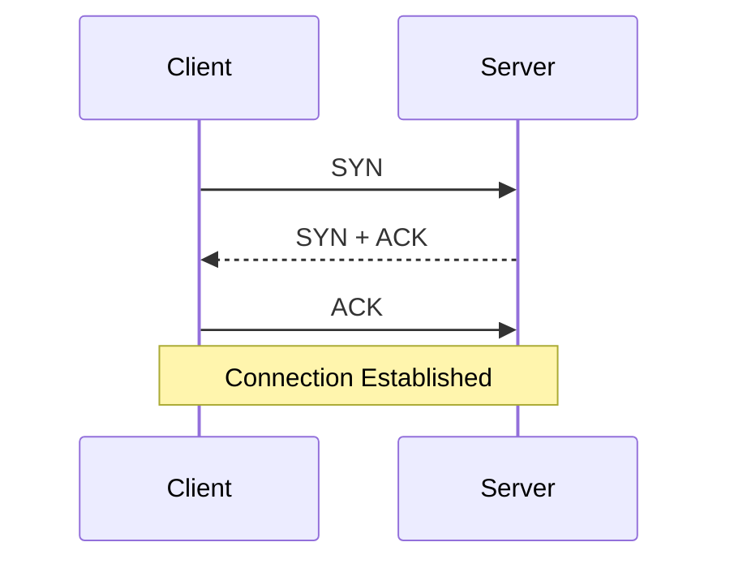

# Connection Establishment

> *Before sending application data, TCP first establishes a reliable communication channel.*

---

# Why Does TCP Need A Connection?

Suppose DNS has already resolved

```
github.com

↓

140.82.xx.xx
```

The browser now knows where GitHub is.

Question:

Can it immediately send

```http
GET /
```

No.

The client first needs to know:

- Is the server alive?
- Is anyone listening on the destination port?
- Can packets reach the server?
- Can the server send packets back?

Only after confirming these can application data be exchanged.

---

# Ports

An IP address identifies a computer.

A **port** identifies an application running on that computer.

Example

```
140.82.xx.xx

↓

443 → HTTPS

22 → SSH

25 → SMTP
```

Without ports,

every application on the computer would receive every packet.

---

# The Four-Tuple

A TCP connection is uniquely identified by:

```
Source IP

↓

Source Port

↓

Destination IP

↓

Destination Port
```

Example

```
192.168.1.15:52341

↓

140.82.114.3:443
```

If another browser tab connects,

only the **Source Port** changes.

This allows millions of simultaneous TCP connections.

---

# Ephemeral Ports

Applications usually don't choose source ports.

The operating system automatically selects an unused temporary port.

Example

```
Browser

↓

192.168.1.10:52341

↓

github.com:443
```

These temporary ports are called **Ephemeral Ports**.

---

# Sockets

Applications do not communicate directly with TCP.

Instead they use **Sockets**.

```
Application

↓

Socket

↓

TCP

↓

IP

↓

Network
```

A socket is the interface between an application and the operating system's networking stack.

---

# The Three-Way Handshake

Every TCP connection begins with three packets.



Only after this process completes can application data be exchanged.

---

# Step 1 — SYN

The client sends

```
SYN
```

Meaning

> "I'd like to establish a TCP connection."

The SYN packet also contains the client's **Initial Sequence Number (ISN).**

Example

```
Flags

SYN

Sequence Number

82491352
```

No application data is sent.

---

# Why Random Sequence Numbers?

Suppose every connection always began with

```
Sequence = 1
```

A delayed packet from an old connection could be mistaken for part of a new one.

Random Initial Sequence Numbers make this extremely unlikely.

---

# Step 2 — SYN + ACK

The server receives the SYN.

If an application is listening,

the kernel replies

```
SYN

+

ACK
```

Meaning

- I received your SYN.
- Here is my own Initial Sequence Number.

Example

```
Sequence = 5219000

ACK = 82491353
```

---

# Step 3 — ACK

The client replies

```
ACK
```

Meaning

> "I received your SYN."

At this point,

both sides know

- The other machine is reachable.
- Both agreed on starting sequence numbers.
- Both are ready for data transfer.

The TCP connection enters the **ESTABLISHED** state.

---

# Why Three Packets?

A common question is:

> Why not two?

The final ACK confirms that both machines have successfully synchronized.

Without it,

the server cannot know whether the client received the server's SYN.

---

# Packet Walkthrough

```
Packet 1

Flags: SYN

Seq = X

────────────────────

Packet 2

Flags: SYN, ACK

Seq = Y

Ack = X + 1

────────────────────

Packet 3

Flags: ACK

Seq = X + 1

Ack = Y + 1
```

This is exactly what you'll see in Wireshark.

---

# Connection States

During connection establishment,

the kernel tracks several states.

```
Client

CLOSED

↓

SYN_SENT

↓

ESTABLISHED
```

Server

```
LISTEN

↓

SYN_RECEIVED

↓

ESTABLISHED
```

Applications usually never see these states.

The operating system manages them internally.

---

# What Happens Next?

Once the connection reaches

```
ESTABLISHED
```

the browser finally sends

```http
GET /
```

If HTTPS is used,

the TLS handshake begins immediately after the TCP handshake.

---

# Node.js Example

```javascript
const net = require("net");

const socket = net.createConnection({
  host: "example.com",
  port: 80
});
```

Node.js does **not** implement TCP.

It requests a socket from the operating system.

The Linux kernel then performs:

- Socket creation
- Ephemeral port allocation
- Three-Way Handshake
- State management
- Retransmissions

Node.js simply reads and writes bytes.

---

# Real World Example

Opening

```
https://github.com
```

typically performs

```
Browser

↓

DNS

↓

TCP Handshake

↓

TLS Handshake

↓

HTTP Request

↓

HTTP Response
```

The user only notices the webpage loading.

Several networking protocols cooperate behind the scenes.

---

# Practical

Start a local HTTP server

```bash
python -m http.server 8000
```

In another terminal

```bash
curl http://localhost:8000
```

Observe the connection

Linux

```bash
ss -tan
```

Windows

```powershell
netstat -ano
```

Capture packets using Wireshark

Filter

```
tcp.port == 8000
```

Observe

```
SYN

↓

SYN ACK

↓

ACK
```

---

# Summary

- TCP establishes a connection before sending data.
- Every connection begins with a Three-Way Handshake.
- Applications communicate through sockets.
- Every TCP connection is uniquely identified by a four-tuple.
- The operating system manages connection states.
- HTTP begins only after TCP finishes establishing the connection.

---

# Where You'll Use This

## Developer

- Socket Programming
- REST APIs
- Web Servers

## DevOps

- Load Balancers
- Reverse Proxies
- Kubernetes Services

## Cybersecurity

- Packet Analysis
- Port Scanning
- Traffic Inspection

## Interview

- Explain the Three-Way Handshake.
- Why are sequence numbers random?
- Why are ephemeral ports necessary?
- What uniquely identifies a TCP connection?

---

# Common Mistakes

❌ Thinking applications implement TCP.

❌ Confusing ports with IP addresses.

❌ Assuming TCP starts sending application data immediately.

❌ Believing a connection is identified only by IP addresses.

---

# Related Topics

- NET-002.1 — History
- NET-002.3 — Reliability
- NET-003 — TLS

---

# Next

➡ **03-Reliability.md**