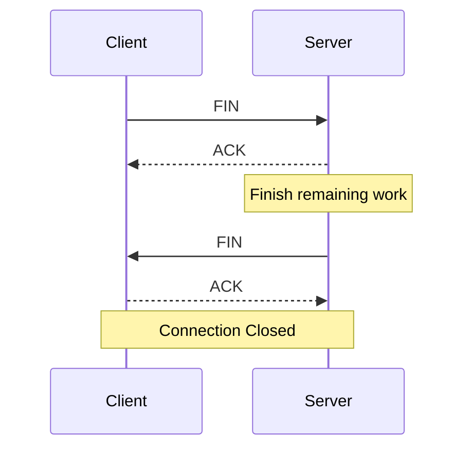

# TCP Connection Termination

> *Closing a TCP connection is more complicated than opening one because communication is bidirectional.*

---

# The Problem

Suppose you've finished uploading a file.

Should TCP immediately destroy the connection?

No.

The other side may still have data to send.

Example

```
Client

────────────►

Finished Uploading

Server

◄────────────

Still Sending Response
```

TCP therefore closes each direction independently.

---

# Full Duplex

TCP allows

both sides

to send and receive

simultaneously.

```
Client

────────────►

Data

◄────────────

Data

Server
```

Each direction is independent.

This is called

**Full Duplex Communication.**

---

# Half-Close

Suppose

the client has finished sending.

It sends

```
FIN
```

Meaning

> "I have no more data to transmit."

Notice

the client can still

**receive**

data.

Only one direction has closed.

This is called

**Half-Close**.

---

# FIN

The FIN flag means

```
No More Data To Send
```

It does **not** mean

```
Destroy Connection
```

The receiving side may continue transmitting until it is also finished.

---

# Four-Way Termination

TCP normally closes using

four packets.



Each direction closes independently.

---

# Why Four Packets?

The server may still need time to

- Finish processing
- Write logs
- Send a response
- Flush remaining data

It cannot send FIN immediately unless it is also finished transmitting.

---

# FIN + ACK

Sometimes

the server has already completed its work.

Instead of sending

```
ACK

↓

FIN
```

it combines both into

```
FIN + ACK
```

Saving one packet.

Wireshark commonly displays this behavior.

---

# TCP State Machine

Client

```
ESTABLISHED

↓

FIN_WAIT_1

↓

FIN_WAIT_2

↓

TIME_WAIT

↓

CLOSED
```

Server

```
ESTABLISHED

↓

CLOSE_WAIT

↓

LAST_ACK

↓

CLOSED
```

These states are managed entirely by the operating system.

---

# TIME_WAIT

One of TCP's most misunderstood states.

Imagine

the server sends

```
FIN
```

The client's

```
ACK
```

gets lost.

The server retransmits

FIN.

If the client immediately destroyed the connection,

it could never acknowledge

the retransmitted FIN.

Instead,

the client waits.

This state is called

```
TIME_WAIT
```

---

# 2 × MSL

TIME_WAIT lasts

```
2 × MSL
```

MSL

=

Maximum Segment Lifetime.

Purpose

- Allow retransmitted FIN packets.
- Ensure delayed packets disappear before reusing the same connection.

This prevents old packets from interfering with future connections.

---

# CLOSE_WAIT

Suppose

the peer sends

```
FIN
```

The kernel informs

the application.

However,

the application forgets to close its socket.

Linux waits.

The connection remains in

```
CLOSE_WAIT
```

Large numbers of

CLOSE_WAIT

connections usually indicate

an application bug.

---

# LAST_ACK

After the application finally closes,

Linux sends

```
FIN
```

and waits for

the final ACK.

State

```
LAST_ACK
```

Once acknowledged,

the connection is removed.

---

# RST (Reset)

Unlike

```
FIN
```

which closes gracefully,

```
RST
```

immediately terminates the connection.

RST is used when

- No process is listening on the destination port.
- A connection becomes invalid.
- A protocol error occurs.
- An application aborts the connection.

No remaining data is transmitted.

---

# FIN vs RST

| FIN | RST |
|------|-----|
| Graceful shutdown | Immediate termination |
| Remaining data delivered | Pending data discarded |
| Normal application behavior | Error or abnormal termination |
| Four-way termination | Single reset packet |

---

# Linux Example

Node.js

```javascript
socket.end();
```

Requests

a graceful shutdown.

Linux

sends

```
FIN
```

Node.js

```javascript
socket.destroy();
```

Immediately destroys the socket.

Linux typically sends

```
RST
```

instead.

---

# Practical

Open

```bash
python -m http.server 8000
```

Connect

```bash
curl http://localhost:8000
```

Observe

```bash
ss -tan
```

Look for

```
TIME_WAIT

CLOSE_WAIT

ESTABLISHED
```

Capture traffic using Wireshark.

Observe

```
FIN

↓

ACK

↓

FIN

↓

ACK
```

---

# Real World Example

Suppose

your Vulnerability Scanner communicates with PostgreSQL.

```
Scanner

↓

TCP

↓

PostgreSQL
```

When the query finishes,

both sides gracefully close the connection.

If the application crashes,

Linux may instead terminate the connection using

```
RST
```

---

# Engineering Insight

Opening a TCP connection is only half the story.

Closing it correctly ensures

- Remaining data is delivered.
- Duplicate packets cannot corrupt future connections.
- Kernel resources are safely released.

Reliable shutdown is just as important as reliable transmission.

---

# Summary

- TCP closes each communication direction independently.
- FIN means "I have finished sending."
- RST immediately aborts a connection.
- TIME_WAIT protects against delayed packets.
- CLOSE_WAIT usually indicates an application has not closed its socket.
- The kernel manages all TCP state transitions.

---

# Where You'll Use This

## Developer

- Socket Programming
- Database Connections
- Backend APIs

## DevOps

- Linux Networking
- Connection Leaks
- Performance Troubleshooting

## Cloud

- Kubernetes Pods
- Load Balancers
- Reverse Proxies

## Cybersecurity

- Packet Analysis
- Network Forensics
- Firewall Debugging

## Interview

- Why does TCP use four packets to terminate?
- What is TIME_WAIT?
- What is CLOSE_WAIT?
- Difference between FIN and RST?

---

# Common Mistakes

❌ Thinking FIN immediately destroys the connection.

❌ Assuming TIME_WAIT is an error.

❌ Ignoring thousands of CLOSE_WAIT sockets.

❌ Believing applications manually construct FIN packets.

---

# Related Topics

- NET-002.5 — Congestion Control
- NET-002.7 — Production TCP

---

# Next

➡ **07-Production.md**