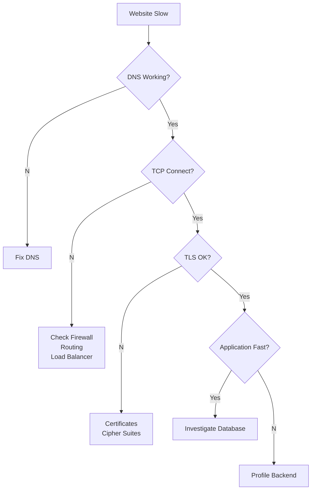

# TCP Debugging & Labs

> *Knowing TCP theory is useful. Being able to debug a broken TCP connection is what makes you an engineer.*

---

# Learning Goals

After completing this chapter you should be able to

- Read TCP packets in Wireshark
- Inspect Linux TCP connections
- Debug failed connections
- Recognize retransmissions
- Identify packet loss
- Read TCP state transitions
- Troubleshoot slow applications
- Understand where delays occur

---

# Debugging Mindset

Never assume

```
Application Bug
```

Instead investigate layer by layer.

```
Application

↓

HTTP

↓

TLS

↓

TCP

↓

IP

↓

DNS

↓

Network
```

Always isolate the failing layer first.

---

# Lab 1 — Viewing TCP Connections

Linux

```bash
ss -tan
```

Windows

```powershell
netstat -ano
```

Typical output

```
LISTEN

ESTABLISHED

TIME_WAIT

CLOSE_WAIT
```

Learn to recognize these states immediately.

---

# Lab 2 — Find Listening Services

Linux

```bash
ss -ltn
```

Example

```
State

LISTEN

0.0.0.0:22

0.0.0.0:80

0.0.0.0:443
```

Questions to ask

- Which ports are open?
- Which applications are listening?
- Should they be exposed?

---

# Lab 3 — Who Owns The Socket?

Linux

```bash
ss -tp
```

Example

```
users:

("node",pid=2451)

("nginx",pid=821)
```

Now you know

which process owns

each TCP connection.

---

# Lab 4 — Capture Packets

Capture

```bash
sudo tcpdump -i any port 80
```

Capture

HTTPS

```bash
sudo tcpdump -i any port 443
```

Save packets

```bash
sudo tcpdump -i any -w capture.pcap
```

Open

```
capture.pcap
```

inside Wireshark.

---

# Lab 5 — Wireshark Filters

Show only TCP

```
tcp
```

HTTP

```
http
```

HTTPS

```
tls
```

Specific Port

```
tcp.port == 443
```

Specific IP

```
ip.addr == 192.168.1.10
```

Retransmissions

```
tcp.analysis.retransmission
```

Duplicate ACKs

```
tcp.analysis.duplicate_ack
```

Reset Packets

```
tcp.flags.reset == 1
```

---

# Lab 6 — Observe Three-Way Handshake

Start

```bash
python -m http.server 8000
```

Request

```bash
curl http://localhost:8000
```

Capture

```
SYN

↓

SYN ACK

↓

ACK
```

Observe

- Sequence Number
- ACK Number
- Window Size

---

# Lab 7 — Observe Connection Termination

Repeat

```
curl
```

Observe

```
FIN

↓

ACK

↓

FIN

↓

ACK
```

Locate

TIME_WAIT

using

```bash
ss -tan
```

---

# Lab 8 — Observe Keep-Alive

```bash
curl -v https://example.com
```

Look for

```
Connection:

keep-alive
```

Notice

the connection

remains open

for additional requests.

---

# Lab 9 — Node.js TCP Client

```javascript
const net = require("net");

const socket = net.createConnection({
    host: "example.com",
    port: 80
});

socket.on("connect", () => {

    socket.write(
`GET / HTTP/1.1\r
Host: example.com\r
\r
`);

});

socket.on("data", data => {

    console.log(data.toString());

    socket.end();

});
```

Run

```bash
node client.js
```

Watch

```
ESTABLISHED

↓

TIME_WAIT
```

using

```
ss -tan
```

---

# Lab 10 — Python TCP Server

```python
import socket

server = socket.socket()

server.bind(("0.0.0.0",8000))

server.listen()

client,address = server.accept()

print(address)
```

Connect

```
curl

↓

Python Server

↓

TCP Connection
```

Observe

LISTEN

↓

ESTABLISHED

↓

CLOSE

---

# Lab 11 — Packet Loss

Capture

a large download

using Wireshark.

Watch for

```
Duplicate ACK

↓

Retransmission

↓

Recovery
```

This demonstrates TCP reliability.

---

# Lab 12 — Reading A TCP Packet

Open

any TCP packet.

Locate

```
Source Port

Destination Port

Sequence Number

Acknowledgement Number

Flags

Window Size

Checksum
```

Every field should now make sense.

---

# Debugging Slow Websites

Never assume

```
Node.js Slow
```

Instead investigate

```
DNS

↓

TCP Handshake

↓

TLS Handshake

↓

HTTP Request

↓

Application

↓

Database
```

Every stage

adds latency.

---

# Production Debugging Workflow



---

# Useful Linux Commands

Sockets

```bash
ss -tan
```

Listening Ports

```bash
ss -ltn
```

Process Ownership

```bash
ss -tp
```

Packet Capture

```bash
tcpdump -i any
```

DNS

```bash
dig example.com
```

HTTP

```bash
curl -v https://example.com
```

TLS

```bash
openssl s_client -connect example.com:443
```

---

# Common TCP States

| State | Meaning |
|--------|---------|
| LISTEN | Waiting for incoming connections |
| SYN_SENT | Client sent SYN |
| SYN_RECEIVED | Server waiting for final ACK |
| ESTABLISHED | Active connection |
| FIN_WAIT_1 | FIN sent |
| FIN_WAIT_2 | Waiting for peer FIN |
| CLOSE_WAIT | Application hasn't closed socket |
| LAST_ACK | Waiting for final ACK |
| TIME_WAIT | Waiting for delayed packets to expire |
| CLOSED | Connection removed |

---

# Real World Example

Suppose

your Vulnerability Scanner

appears slow.

Instead of immediately

optimizing Node.js,

you inspect

```
DNS

↓

TCP

↓

TLS

↓

Fastify

↓

Redis

↓

BullMQ

↓

PostgreSQL
```

The problem

might actually be

packet loss

or

a slow TCP handshake,

not your code.

---

# Engineering Insight

Great engineers

don't memorize

commands.

They understand

**what question each command answers.**

```
Is the port open?

↓

ss

────────────────

What packets were sent?

↓

tcpdump

────────────────

What happened?

↓

Wireshark

────────────────

Is HTTP working?

↓

curl

────────────────

Is TLS working?

↓

openssl
```

Tools answer questions.

Questions solve problems.

---

# Summary

- Learn TCP by observing real packets.
- Use Linux tools before guessing.
- Debug one layer at a time.
- Wireshark visualizes TCP behavior.
- Packet captures reveal retransmissions, ACKs and state transitions.
- Production debugging begins with networking, not assumptions.

---

# Where You'll Use This

## Backend Development

- API Debugging
- Socket Programming
- Performance Analysis

## DevOps

- Linux Servers
- Kubernetes
- Docker Networking

## Cloud

- AWS
- Load Balancers
- EC2

## Cybersecurity

- Packet Analysis
- HTB
- TryHackMe
- Digital Forensics

## Interview

- Explain how you'd debug a slow website.
- Show how to inspect TCP connections.
- Explain TCP states using Linux tools.

---

# Common Mistakes

❌ Blaming the application without checking the network.

❌ Ignoring TCP states.

❌ Capturing packets without filters.

❌ Looking only at HTTP when the problem is below it.

---

# Related Topics

- NET-002.8 — TCP Security
- NET-003 — TLS
- WEB-001 — HTTP

---

# Next

➡ **NET-003 — TLS (Transport Layer Security)**