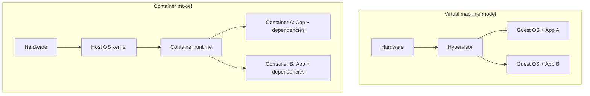
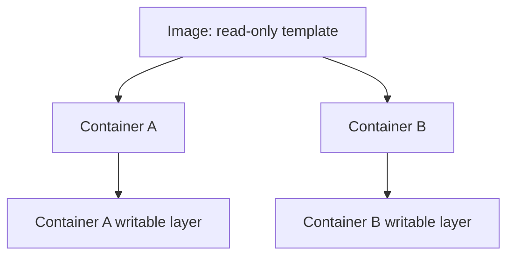
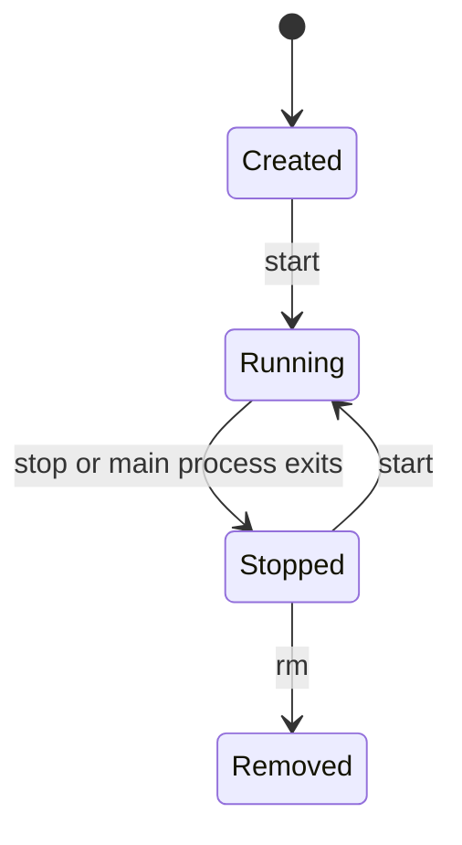

# 01 — Why Containers Exist & Core Concepts

## The problem: software depends on its environment

An application is not only its source code. It also depends on a language runtime, libraries, operating-system packages, configuration, filesystem paths, permissions, and network services.

A project may work on one machine and fail on another because those environments differ. This is the familiar "works on my machine" problem.

Before containers, teams often used manual setup scripts, dedicated servers, or virtual machines. Virtual machines provide strong isolation but each VM usually carries a complete guest operating system, which adds overhead.

Containers package an application and its user-space dependencies while sharing the host operating-system kernel. They provide process and resource isolation without requiring a separate guest kernel for every application.

## VM vs container



A container is not a tiny VM. Linux containers rely on kernel mechanisms such as namespaces for isolation and cgroups for resource accounting and limits. On Windows, Docker Desktop commonly uses a Linux environment through WSL 2 to run Linux containers.

## Core vocabulary

| Term | Meaning |
|---|---|
| Docker Engine | Software used to build and run containers |
| Docker daemon | Background service that manages Docker objects |
| Docker CLI | Client used to send commands to the Engine |
| Image | Layered, mostly immutable template |
| Container | A created/running instance of an image |
| Registry | Service that stores and distributes images |
| Runtime | Component that starts and manages container processes |

## Image vs container



One image can create many containers. Each container gets its own writable layer. Removing a container does not automatically remove the image, and important data should not be kept only in the container's writable layer.

## First verification

```powershell
docker version
docker run hello-world
docker images
docker ps -a
```

- `docker version` checks client and server versions.
- `docker run hello-world` verifies that the CLI can communicate with the Engine, retrieve an image if necessary, create a container, and execute it.
- `docker images` lists local images.
- `docker ps -a` lists running and stopped containers.

## Container lifecycle



A container normally remains running only while its configured main process remains running. The container is not a full operating system that independently stays alive.

## Knowledge check

1. What is the difference between an image and a container?
2. Why is a container not the same thing as a virtual machine?
3. What happens to an image when a container created from it is removed?
4. Why should important database files not live only in the container writable layer?

## Related

- [[NET-001 — DNS]]
- [[NET-002 — TCP]]
- [[OS-001 — Linux Filesystem]]
- [[OS-002 — Processes]]
- [[DEV-004 — Docker & Containerization]]
