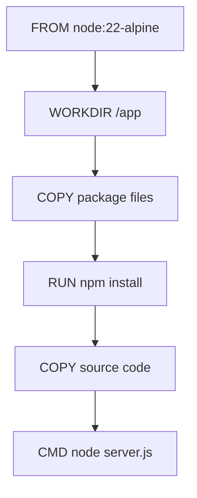

# 02 — Dockerfiles, Images & Build Cache

## Why a Dockerfile?

A Dockerfile makes the image-building process repeatable. Instead of manually configuring a machine, we describe the runtime, working directory, files, dependencies, exposed application port, and startup command.

## Example: Node.js API

```dockerfile
FROM node:22-alpine

WORKDIR /app

COPY package*.json ./
RUN npm install

COPY . .

EXPOSE 3000

CMD ["node", "server.js"]
```

| Instruction | Purpose |
|---|---|
| `FROM` | Selects the base image |
| `WORKDIR` | Sets the working directory for later instructions |
| `COPY` | Copies files from the build context into the image |
| `RUN` | Executes a command while building the image |
| `EXPOSE` | Documents the port the application expects to use |
| `CMD` | Sets the default command when the container starts |

**EXPOSE does not publish a host port.** Host port publishing is configured with `docker run -p` or Compose `ports:`.

## Image layers and cache

Docker can reuse build steps when their instructions and inputs have not changed. Order instructions so relatively stable dependencies are installed before frequently changing source code.



If only `server.js` changes, the package files are unchanged, so Docker can reuse the dependency-installation layer. If `package.json` or the lockfile changes, dependencies need to be installed again.

## Build context and .dockerignore

The build context is the set of files made available to the image builder. A typical `.dockerignore` is:

```text
node_modules
.git
.env
npm-debug.log
```

This prevents unnecessary local files and secrets from entering the build context.

Do not confuse:

- `.gitignore`: controls which untracked files Git should ignore.
- `.dockerignore`: controls which files are excluded from the Docker build context.

Neither file is a secrets manager. A secret copied into an image layer can remain in the image history even if a later layer deletes the file.

## Build and run

```powershell
docker build -t layer-cache-demo .
docker run --name layer-cache-test -p 3000:3000 layer-cache-demo
```

Rebuild and recreate a container after changing image content:

```powershell
docker stop layer-cache-test
docker rm layer-cache-test
docker build -t layer-cache-demo .
docker run --name layer-cache-test -p 3000:3000 layer-cache-demo
```

An already-created container does not magically change when a new image is built. Recreate it from the new image.

## Knowledge check

1. Why copy package files before application source?
2. Does EXPOSE publish the port to the Windows host?
3. What is the build context?
4. How are .gitignore and .dockerignore different?
5. Why does rebuilding an image not update an existing container?

## Related

- [[DEV-004 — Docker & Containerization]]
- [[BE-003 — Express]]
