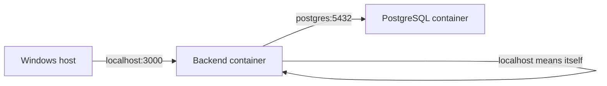

# 03 — Container Networking & Service Discovery

## Why container networking matters

Containers are isolated environments. A backend container and a database container need a network path to communicate, while users on the host machine need a published port to reach the backend.

## Published ports

Port mapping uses this order:

```text
HOST_PORT:CONTAINER_PORT
```

Example:

```powershell
docker run --name api -p 8080:3000 my-node-image
```

Traffic sent to host port `8080` is forwarded to port `3000` inside the container.


The host port and container port do not need to be the same. Multiple containers can listen on port 3000 internally, but they cannot all publish the same host IP/port combination simultaneously.

## Docker bridge networks

A bridge network acts like a virtual network switch for containers. User-defined bridge networks provide automatic DNS resolution between containers attached to that network.

```powershell
docker network create app-network
docker run -d --name web --network app-network nginx
docker run --rm --network app-network busybox nslookup web
```

Use `docker network ls` to list networks and `docker network inspect <network-name>` to see connected containers and network details.

## localhost is relative to the container

Inside a container, `localhost` refers to that same container.

For a backend container connecting to a separate PostgreSQL service named `postgres`, use:

```javascript
const pool = new Pool({
  host: "postgres",
  port: 5432
});
```

Not:

```javascript
host: "localhost"
```

The backend's localhost would point back to the backend container, not to the PostgreSQL container.



## Common networks

| Network | Meaning |
|---|---|
| bridge | Default Docker bridge network |
| host | Host networking mode; behavior depends on platform |
| none | No normal container networking |
| project_default | Compose-created network for a project |
| kind | Commonly created by Kubernetes-in-Docker tooling |

Compose typically creates a private default network for a project and attaches its services to it. Service names become DNS names on that network.

## Debugging

```powershell
docker network ls
docker network inspect <network-name>
docker ps
docker inspect <container-name>
```

Check that the containers are running and attached to the expected network. Confirm the database hostname matches the Compose service name.

## Knowledge check

1. In `-p 8080:3000`, which port belongs to the host?
2. Can two containers use the same internal port?
3. What does localhost mean inside the backend container?
4. Why can the backend resolve the hostname postgres?
5. What does a Compose-created default network provide?

## Related

- [[NET-001 — DNS]]
- [[NET-002 — TCP]]
- [[DEV-004 — Docker & Containerization]]
- [[DEV-005 — Docker Compose]]
