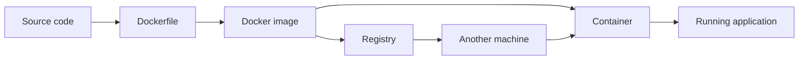
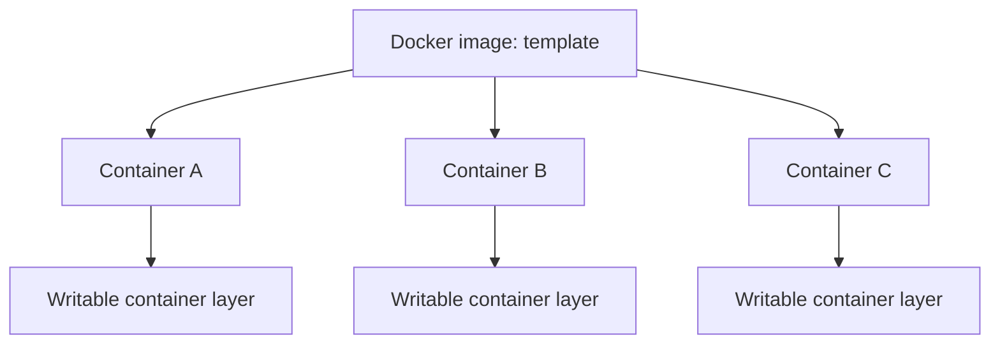
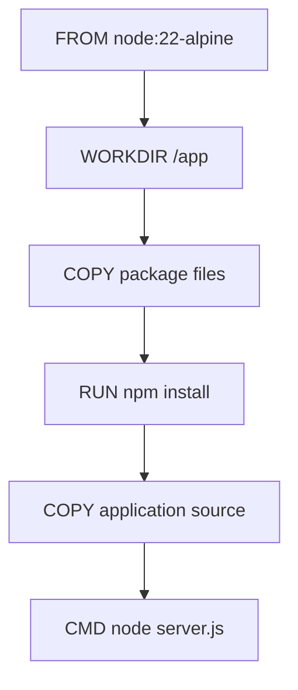
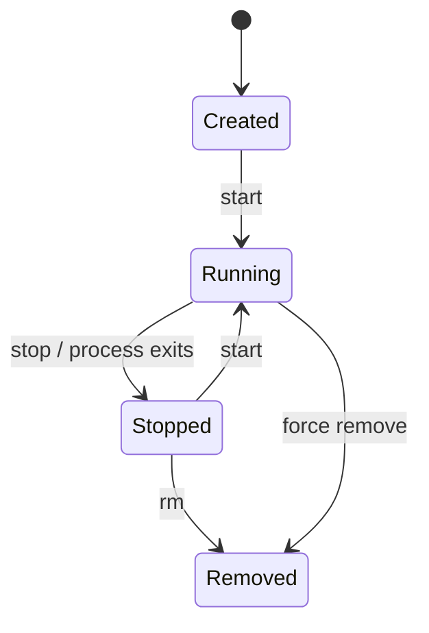
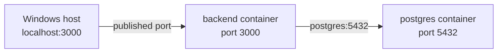
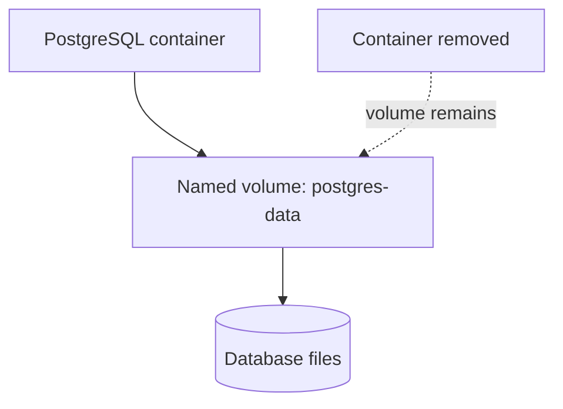
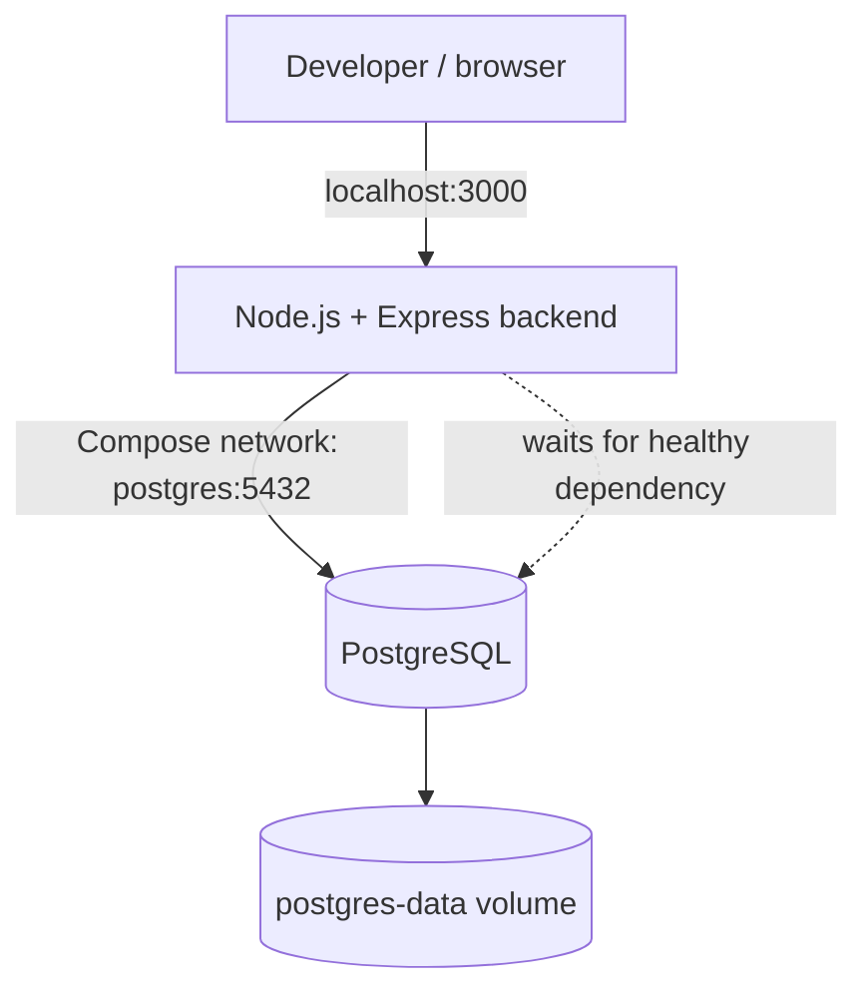
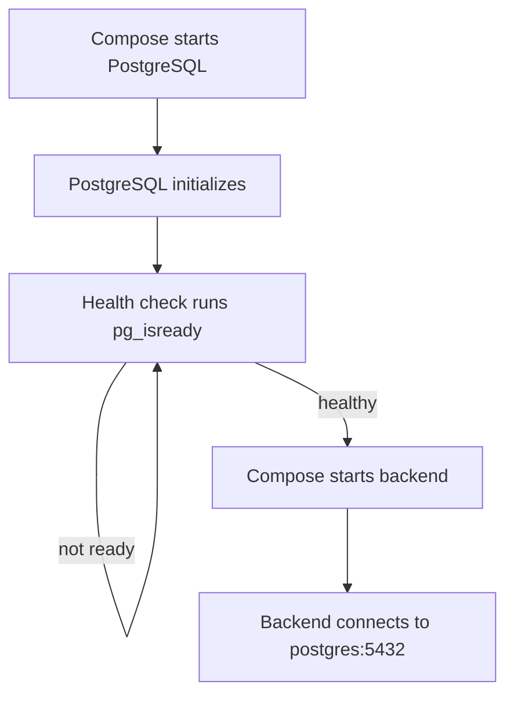
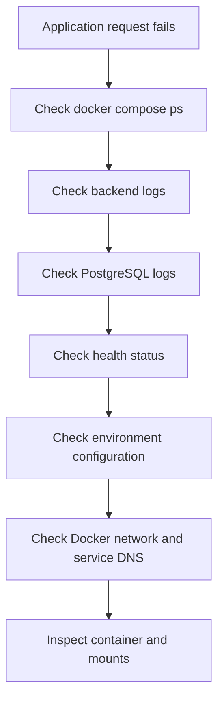

# DEV-004 — Docker & Containerization

> Docker packages an application and its runtime dependencies into an image, then runs that image as an isolated container.

## Summary

Docker helps developers build, distribute, and run applications consistently across development, testing, and production environments. An image is the packaged template; a container is a running instance of that image. Docker also provides networking, persistent storage, build caching, and multi-container orchestration through Docker Compose.

This note records the practical Docker learning path: from running the first container to building a Node.js + PostgreSQL application with Compose.

---

## 1. Why Docker Exists

### The problem before containers

Software depends on more than source code. It also depends on:

- A particular language runtime and runtime version
- OS libraries and native packages
- Configuration and environment variables
- Filesystem paths and permissions
- Network services such as databases and caches

An application might work on one developer's laptop but fail on another machine or in production because the environments differ.

Typical symptoms:

- "Works on my machine."
- Different Node.js or Python versions
- Missing system libraries
- Dependency conflicts between projects
- Complicated setup instructions
- Inconsistent deployment environments

### The idea

Package the application and its required runtime environment into an image. Run the image as a container wherever a compatible container runtime is available.



Containers do not contain a complete virtual machine and a separate guest kernel. They use OS-level isolation mechanisms provided by the host kernel. On Windows, Docker Desktop commonly runs Linux containers through its Linux/WSL 2 environment.

---

## 2. Core Concepts

| Concept | Meaning |
|---|---|
| Docker Engine | Builds and runs containers; includes the daemon and API |
| Docker CLI | Client used to issue commands such as `docker run` |
| Image | Immutable, layered template used to create containers |
| Container | A runnable instance of an image, with its own writable layer |
| Dockerfile | Instructions for building an image |
| Registry | Stores and distributes images, for example Docker Hub |
| Volume | Docker-managed persistent storage |
| Bind mount | Maps a host filesystem path into a container |
| Network | Connects containers and controls their communication |
| Docker Compose | Defines and runs a multi-container application |
| Build context | Files made available to the Docker image builder |

### Image vs container



An image can create multiple containers. Each container has its own writable layer, while the image layers are shared read-only.

Removing a container does not automatically remove its image. Removing a container also does not remove data stored in an independently managed named volume.

---

## 3. Images, Layers, and Build Cache

Docker builds images from instructions in a Dockerfile. Most build instructions produce layers. Docker can reuse a previous layer when the instruction and its relevant inputs have not changed.

Example:

```dockerfile
FROM node:22-alpine

WORKDIR /app

COPY package*.json ./
RUN npm install

COPY . .

EXPOSE 3000

CMD ["node", "server.js"]
```

Why copy package files before application code?

1. Dependency installation depends on `package.json` and the lockfile.
2. Application source code changes more frequently than dependency declarations.
3. When only `server.js` changes, Docker can usually reuse the dependency-installation layer.
4. When the package files change, Docker needs to rebuild the dependency layer.



### Build context and `.dockerignore`

The build context is the set of files sent to the builder. Use `.dockerignore` to exclude unnecessary or sensitive files from that context.

Example:

```text
node_modules
.git
.env
npm-debug.log
```

This avoids sending local dependencies, Git history, logs, and local environment secrets into the build context.

**Important:** `.dockerignore` and `.gitignore` solve different problems. The former affects the Docker build context; the latter prevents matching files from being tracked by Git. Neither replaces secret management.

---

## 4. Container Lifecycle

A container is created from an image and then started. It can be stopped, restarted, inspected, or removed.



A container usually runs as long as its main process runs. It is not a lightweight virtual machine that remains alive independently of its configured process.

### First container

```powershell
docker run hello-world
```

This is a useful first test because Docker must locate or pull the image, create a container, execute its process, and display its output.

---

## 5. Networking

Containers are isolated network environments. Docker networks connect containers and provide service discovery.

### Published ports

The syntax is:

```text
HOST_PORT:CONTAINER_PORT
```

Example:

```powershell
docker run --name web -p 8080:3000 my-node-image
```

Traffic to host port `8080` is forwarded to port `3000` in the container.

Two containers can listen on the same internal port, such as `3000`, while publishing different host ports.

### Container-to-container communication

On a user-defined bridge network or a Compose-created network, containers can usually discover each other by container or Compose service name.



For a backend container connecting to a PostgreSQL service named `postgres`, use:

```javascript
const pool = new Pool({
  host: "postgres",
  port: 5432
});
```

Do not use `localhost` for a separate PostgreSQL container. Inside the backend container, `localhost` refers to the backend container itself.

### Networks observed in Docker

Common network names include:

| Network | Purpose |
|---|---|
| `bridge` | Default Docker bridge network |
| `host` | Host networking mode, with platform-specific behavior |
| `none` | Disables normal container networking |
| `<project>_default` | Automatically created Compose network |
| `kind` | Often created by a local Kubernetes-in-Docker setup |

A network is like a virtual switch: containers attached to the same network can communicate according to its networking and firewall rules.

---

## 6. Persistent Storage

A container's writable layer is not the right place for important data that must outlive the container.

Docker provides two common ways to mount host or Docker-managed storage.

### Named volume

A named volume is managed by Docker and can be reused by different containers.

```powershell
docker volume create demo-data
docker run --rm -v demo-data:/data alpine sh -c "echo persistent > /data/message.txt"
docker run --rm -v demo-data:/data alpine cat /data/message.txt
```

The second container can read the file even though the first container was removed.

### Bind mount

A bind mount maps a particular host path into a container. It is useful in development when source changes should be visible inside the container.

```powershell
docker run --rm -v "${PWD}:/app" node:22-alpine ls /app
```

| Named volume | Bind mount |
|---|---|
| Managed by Docker | Uses a specific host path |
| Good for persistent application data | Good for source-code sharing and development |
| Not tied to a particular project directory | Depends on host filesystem layout |



**Cleanup warning:** `docker compose down -v` removes Compose-managed named volumes declared by the project. This deletes the data in those volumes. Do not use it on a database whose data you need.

---

## 7. Docker Compose

Running every service manually with separate `docker run` commands becomes cumbersome. Docker Compose lets us describe an application stack in one YAML file.

Example architecture:



### Example project layout

```text
docker-real-app/
├── server.js
├── package.json
├── package-lock.json
├── Dockerfile
├── compose.yaml
├── .env
├── .gitignore
└── .dockerignore
```

### Dockerfile

```dockerfile
FROM node:22-alpine
WORKDIR /app
COPY package*.json ./
RUN npm install
COPY . .
EXPOSE 3000
CMD ["node", "server.js"]
```

### Express backend

```javascript
const express = require("express");
const { Pool } = require("pg");

const app = express();

const pool = new Pool({
  host: "postgres",
  port: 5432,
  user: process.env.POSTGRES_USER,
  password: process.env.POSTGRES_PASSWORD,
  database: process.env.POSTGRES_DB
});

app.get("/", (req, res) => {
  res.json({ message: "Backend is running!" });
});

app.get("/db", async (req, res) => {
  try {
    const result = await pool.query("SELECT NOW()");
    res.json({
      message: "Connected to PostgreSQL!",
      time: result.rows[0].now
    });
  } catch (error) {
    console.error(error);
    res.status(500).json({ error: "Database connection failed" });
  }
});

app.listen(3000, "0.0.0.0", () => {
  console.log("Server running on port 3000");
});
```

The server binds to `0.0.0.0` so it can accept traffic arriving through the container's network interface, not only loopback traffic.

### `compose.yaml`

This example uses PostgreSQL 18. For PostgreSQL 18 and later official images, the recommended persistent mount target is `/var/lib/postgresql`, rather than the older `/var/lib/postgresql/data` target.

```yaml
services:
  backend:
    build: .
    ports:
      - "3000:3000"
    environment:
      POSTGRES_USER: ${POSTGRES_USER}
      POSTGRES_PASSWORD: ${POSTGRES_PASSWORD}
      POSTGRES_DB: ${POSTGRES_DB}
    depends_on:
      postgres:
        condition: service_healthy

  postgres:
    image: postgres:18-alpine
    environment:
      POSTGRES_USER: ${POSTGRES_USER}
      POSTGRES_PASSWORD: ${POSTGRES_PASSWORD}
      POSTGRES_DB: ${POSTGRES_DB}
    volumes:
      - postgres-data:/var/lib/postgresql
    healthcheck:
      test: ["CMD-SHELL", "pg_isready -U ${POSTGRES_USER} -d ${POSTGRES_DB}"]
      interval: 5s
      timeout: 5s
      retries: 5

volumes:
  postgres-data:
```

Compose automatically creates a project network and attaches the services to it. The backend can resolve the database using the service name `postgres`.

---

## 8. Configuration and Secrets

Do not hardcode credentials in application source files.

### `.env`

```env
POSTGRES_USER=appuser
POSTGRES_PASSWORD=replace-with-a-local-development-password
POSTGRES_DB=appdb
```

Compose reads the project `.env` file for interpolation. The `environment` entries pass those resolved values into the containers.

### Keep secrets out of Git and image builds

`.gitignore`:

```text
node_modules
.env
```

`.dockerignore`:

```text
node_modules
.git
.env
npm-debug.log
```

These files are not encryption. Environment variables can still be exposed through container inspection, process diagnostics, logs, or other access paths. For production, use a platform's secret-management facility or a dedicated secrets manager, limit access, rotate credentials, and avoid printing secrets.

Also note: Compose's `.env` file is primarily an input for variable interpolation; containers only receive variables explicitly passed through `environment` or `env_file`.

---

## 9. Health Checks and Startup Dependencies

A service being started does not necessarily mean it is ready to accept application traffic.

`depends_on` in its short form establishes dependency startup order, but does not by itself wait for the dependency to become ready.

A health check tests service readiness. With:

```yaml
depends_on:
  postgres:
    condition: service_healthy
```

Compose waits for the PostgreSQL service's health check to pass before starting the dependent backend service.

For the PostgreSQL image, `pg_isready` checks whether the server is accepting connections.



A health check is not a substitute for application-level retry and error handling. Dependencies can become unavailable after startup, so robust applications should still handle transient connection failures.

---

## 10. Essential Commands

| Command | Purpose |
|---|---|
| `docker version` | Check Docker client and server versions |
| `docker run hello-world` | Verify the basic Docker workflow |
| `docker images` | List local images |
| `docker ps` | List running containers |
| `docker ps -a` | List all containers, including stopped ones |
| `docker build -t app .` | Build an image from the current directory |
| `docker run -p 8080:3000 app` | Run and publish a container port |
| `docker stop <name>` | Stop a running container |
| `docker rm <name>` | Remove a stopped container |
| `docker volume ls` | List named volumes |
| `docker network ls` | List Docker networks |
| `docker logs <name>` | Read container logs |
| `docker exec -it <name> sh` | Open a shell in a running container |
| `docker inspect <name>` | Inspect low-level container configuration |
| `docker compose config` | Parse and render the resolved Compose model |
| `docker compose up --build` | Build required images and start Compose services |
| `docker compose ps` | Show Compose service/container status |
| `docker compose logs -f backend` | Follow backend logs |
| `docker compose down` | Stop and remove Compose containers and network |
| `docker compose down -v` | Also remove Compose-managed named volumes |

PowerShell note: use the exact container names shown by `docker ps -a` or `docker compose ps`. Compose-generated container names can vary by project and Compose version.

---

## 11. Practical Lab — Node.js + PostgreSQL

### Goal

Run an Express API and PostgreSQL in separate containers. The API should respond to an HTTP request and query the database.

### Environment

- Docker Desktop with the Linux container engine
- WSL 2 on Windows (for the local setup used in this lab)
- Node.js project with `express` and `pg`
- Docker Compose

### Steps

1. Create the project structure shown in Section 7.
2. Install dependencies with `npm install express pg`.
3. Add the Express application and Dockerfile.
4. Create `.env`, `.gitignore`, and `.dockerignore`.
5. Add the Compose configuration with a PostgreSQL health check.
6. Validate the YAML before starting:

```powershell
docker compose config
```

7. Build and start the services:

```powershell
docker compose up --build
```

8. Test the backend:

- `http://localhost:3000`
- `http://localhost:3000/db`

9. Inspect service health:

```powershell
docker compose ps
docker compose logs backend
docker compose logs postgres
```

### Expected result

The root route returns:

```json
{
  "message": "Backend is running!"
}
```

The `/db` route returns a success message and a database timestamp.

### Persistence verification

1. Stop and remove the Compose containers without removing volumes:

```powershell
docker compose down
```

2. Start the stack again:

```powershell
docker compose up --build
```

3. The named PostgreSQL volume remains available. In this minimal lab, the database has no application tables yet, but PostgreSQL's initialized data directory persists.

4. Only use the following when intentionally resetting the local database:

```powershell
docker compose down -v
```

---

## 12. Debugging

Debug from observable evidence instead of changing multiple things at once.

### First-response checklist



### Common problems

| Symptom | Likely cause | Diagnosis / fix |
|---|---|---|
| No rows in `docker ps` | No containers are currently running | Use `docker ps -a` and `docker compose ps` |
| `localhost:5432` connection refused in backend | Backend is trying to reach itself | Use the Compose service name, e.g. `postgres:5432` |
| `connection refused` during startup | Database is not ready yet | Add a health check and `condition: service_healthy`; retain retry handling in the app |
| `healthcheck must be a mapping` | YAML indentation or structure is invalid | Ensure `healthcheck:` contains indented fields such as `test`, `interval`, `timeout`, and `retries` |
| PostgreSQL 18 reports old data mount at `/var/lib/postgresql/data` | Old volume mount target used with the PostgreSQL 18 image layout | Mount the volume at `/var/lib/postgresql`; preserve or migrate real data carefully |
| Host port already allocated | Another process/container uses the host port | Change the host side of the mapping, e.g. `3001:3000` |
| Container name conflict | A container with that name already exists | Inspect it, stop it if needed, then remove it |
| Updated source does not appear | Existing container still runs its old image or source was not mounted | Rebuild and recreate the container |
| Data disappears after reset | Named volume was removed | Avoid `down -v` unless data deletion is intentional |

### Useful commands

```powershell
docker compose ps
docker compose logs -f backend
docker compose logs postgres
docker compose config
docker network ls
docker network inspect <network-name>
docker inspect <container-name>
docker exec -it <container-name> sh
```

---

## 13. Security Considerations

Containers are an isolation and packaging mechanism, not a complete security boundary by themselves.

- Do not bake secrets into Dockerfiles or image layers.
- Keep local `.env` files out of Git and the image build context.
- Prefer non-root users in application containers when practical.
- Use trusted, maintained base images and update them regularly.
- Pin important dependencies and use lockfiles.
- Avoid publishing database ports to the host unless local access is needed.
- Do not mount the Docker socket into an application container without a strong reason.
- Limit Linux capabilities and avoid privileged containers.
- Scan images and dependencies for known vulnerabilities.
- Treat untrusted images and build scripts as executable code.

A named volume preserves data; it does not encrypt it or make it safe from a host administrator or a process with sufficient access.

---

## 14. Production Usage

A production deployment often separates the application from its stateful dependencies:

- Build the backend image in CI.
- Tag and publish the image to a registry.
- Deploy the image to a container runtime or orchestrator.
- Inject environment configuration and secrets at deployment time.
- Use managed database infrastructure or carefully operate a persistent database.
- Configure health checks, resource limits, logs, metrics, and restart behavior.
- Use orchestration such as Kubernetes when the deployment needs scheduling, service discovery, scaling, and rollout management.

Compose is particularly useful for local development, integration tests, and smaller deployments. It is not a replacement for every production orchestration platform.

---

## 15. Interview Questions

### Beginner

1. What is the difference between a Docker image and a container?
2. What does a Dockerfile do?
3. What is a Docker volume?
4. What does `-p 8080:3000` mean?
5. What is Docker Compose?

### Intermediate

1. Why does Docker use layered images?
2. How does Docker build cache work?
3. What is the difference between a bind mount and a named volume?
4. Why should a backend connect to a database using the Compose service name?
5. Why does `depends_on` not necessarily mean a service is ready?
6. What is the difference between `.gitignore` and `.dockerignore`?

### Advanced

1. How do namespaces and cgroups contribute to container isolation and resource control?
2. How would you reduce image size and attack surface?
3. How do you manage secrets in a production container platform?
4. How would you diagnose DNS or packet-connectivity problems between containers?
5. What are the risks of mounting the Docker socket into a container?

---

## 16. Homework

1. Add a `/health` endpoint to the backend.
2. Add a PostgreSQL query that creates a small table and inserts a row.
3. Verify that the row survives `docker compose down` followed by `docker compose up`.
4. Change the host-side port from `3000` to `3001` and explain which port the browser uses.
5. Temporarily set the backend's database hostname to `localhost`, observe the failure, inspect logs, and restore `postgres`.
6. Inspect the Compose network and identify the attached containers.
7. Explain why `docker compose down -v` is dangerous for a database.
8. Research how a Docker image is scanned for vulnerabilities.

---

## 17. Knowledge Check

- [ ] I can explain images, containers, and the container lifecycle.
- [ ] I can write a basic Dockerfile.
- [ ] I understand image layers, build context, and cache reuse.
- [ ] I can explain port publishing.
- [ ] I understand bridge networks and service-name DNS.
- [ ] I can distinguish named volumes from bind mounts.
- [ ] I can run a multi-service stack with Compose.
- [ ] I can configure environment variables without hardcoding credentials.
- [ ] I understand health checks and startup dependencies.
- [ ] I can inspect containers, logs, networks, and Compose configuration.
- [ ] I can troubleshoot a failed backend-to-database connection.
- [ ] I understand the basic security limits and hardening practices for containers.

---

## 18. References

- [Docker Get Started](https://docs.docker.com/get-started/)
- [Dockerfile reference](https://docs.docker.com/reference/dockerfile/)
- [Docker volumes](https://docs.docker.com/engine/storage/volumes/)
- [Docker networking](https://docs.docker.com/engine/network/)
- [Docker Compose](https://docs.docker.com/compose/)
- [Docker Engine security](https://docs.docker.com/engine/security/)
- [Official PostgreSQL image](https://hub.docker.com/_/postgres)

---

## 19. Related Topics

- [[OS-001 — Linux Filesystem]]
- [[OS-002 — Processes]]
- [[NET-001 — DNS]]
- [[NET-002 — TCP]]
- [[BE-003 — Express]]
- [[DB-002 — PostgreSQL]]
- [[DEV-005 — Docker Compose]]
- [[K8S-001 — Containers]]
- [[SEC-009 — Container Security]]

---

## 20. Next Topic

**DEV-005 — Docker Compose**

Deepen the multi-container workflow: service configuration, dependency management, profiles, development overrides, health checks, and operational practices.
