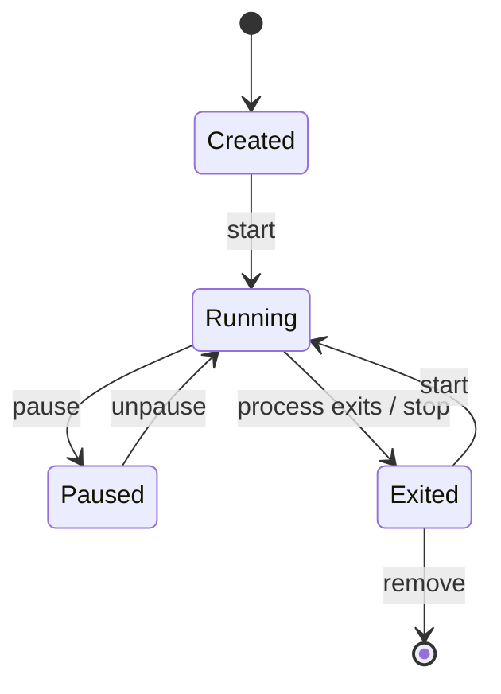

# DEV-005 — Docker Resource Limits, Restart Policies & Lifecycle

> Container operations are not just about starting services: they also require controlling resource consumption and defining what should happen when a process exits.

## 1. Why resource controls matter

Containers share the host's CPU, memory, storage and network resources. A service that consumes too much memory or CPU can affect other workloads on the same host.

Resource limits help make container resource usage more predictable. They are particularly useful when multiple services share a machine.

## 2. CPU limits

In Docker Compose, the `cpus` service property configures the CPU quota available to a container.

```yaml
services:
  backend:
    build: .
    cpus: 0.50
```

A value of `0.50` means the service can use up to half of one CPU's capacity. It is a limit, not a reservation of half a physical core.

Inspect live resource usage with:

```powershell
docker stats
```

The display includes CPU, memory, network I/O and block I/O.

## 3. Memory limits and OOM

A Compose service can have a memory ceiling:

```yaml
services:
  backend:
    build: .
    mem_limit: 256m
```

This configures a 256 MiB memory limit for the container. It is a ceiling, not a guaranteed memory reservation.

If a process in a container exceeds the memory available under its limit, the Linux kernel may invoke the Out Of Memory (OOM) killer and terminate a process.

Inspect the container state:

```powershell
$backendId = docker compose ps -q backend

docker inspect $backendId --format 'OOMKilled={{.State.OOMKilled}} ExitCode={{.State.ExitCode}}'
```

Interpretation:
- `OOMKilled=true` indicates the container was killed due to an out-of-memory condition.
- Exit code `137` commonly indicates SIGKILL (128 + signal 9), but it does not by itself prove an OOM event. Check `OOMKilled` and the surrounding logs/state.

## 4. Restart policies

A restart policy controls whether Docker automatically restarts a container after it exits.

| Policy | Behaviour |
|---|---|
| `no` | Do not automatically restart. This is the default. |
| `on-failure` | Restart when the container exits with a non-zero status. |
| `always` | Always attempt to restart the container after it stops. |
| `unless-stopped` | Restart unless the container was explicitly stopped by the user or Docker. |

Example:

```yaml
services:
  backend:
    build: .
    restart: unless-stopped
```

A restart policy does not repair the application. If the application has a persistent bug or invalid configuration, it may repeatedly crash and restart.

Docker applies restart monitoring only after a container has been up for at least 10 seconds. Manual stops also affect how restart policies behave. See the official restart-policy documentation for the exact behaviour.

## 5. Container lifecycle and commands

A container can be created, started, paused, unpaused, stopped, and removed. The lifecycle is driven by the container's main process and Docker operations.



Useful Compose commands:

| Command | Purpose |
|---|---|
| `docker compose stop` | Gracefully stop service containers. |
| `docker compose start` | Start existing stopped containers. |
| `docker compose restart` | Restart running or stopped service containers. |
| `docker compose kill` | Send a signal to service containers; SIGKILL is the default. |
| `docker compose down` | Stop and remove Compose containers and its network. |
| `docker compose ps -a` | Show Compose containers, including stopped containers. |
| `docker inspect <container>` | Inspect low-level container configuration and state. |

Important distinctions:
- `stop` gives the main process a grace period to shut down before Docker sends SIGKILL.
- `kill` sends a signal immediately; by default it uses SIGKILL.
- `down` removes containers and the Compose network. Named volumes are retained unless `-v` is supplied.
- `restart` does not rebuild an image or apply changed Compose configuration. Recreate containers when configuration changes need to take effect.

## 6. Practical lab: configure resource limits

In the existing Node.js + PostgreSQL Compose project, add these service properties under the backend service while preserving its existing ports, environment, and dependencies:

```yaml
services:
  backend:
    build: .
    cpus: 0.50
    mem_limit: 256m
    restart: unless-stopped
```

Validate and apply:

```powershell
docker compose config
docker compose up -d
docker compose ps
docker stats
```

Press Ctrl+C to leave the live `docker stats` display.

## 7. Practical lab: verify restart behaviour

First verify the configured policy:

```powershell
$backendId = docker compose ps -q backend
docker inspect $backendId --format '{{.HostConfig.RestartPolicy.Name}}'
```

Expected output:

```text
unless-stopped
```

### Experiment A — Unexpected process exit

Terminate the backend's main process:

```powershell
docker compose exec backend sh -c 'kill -TERM 1'
```

Then inspect the service:

```powershell
docker compose ps
docker compose logs --tail=20 backend
```

With `unless-stopped`, Docker should restart the container after this unexpected exit.

### Experiment B — Manual stop

```powershell
docker compose stop backend
docker compose ps -a
```

The backend should remain stopped because it was manually stopped. Start the existing container again:

```powershell
docker compose start backend
```

## 8. Debugging checklist

When a container exits or restarts unexpectedly:

1. Check current and previous container state with `docker compose ps -a`.
2. Read application output with `docker compose logs <service>`.
3. Inspect exit code and OOM state using `docker inspect`.
4. Check configured limits and restart policy.
5. Use `docker stats` to observe resource usage while the service is running.
6. Fix the underlying application or configuration problem instead of relying on restarts alone.

## 9. Key takeaways

- CPU limits constrain the CPU capacity available to a service.
- Memory limits establish a ceiling; they do not reserve memory.
- OOM termination and exit code 137 are related concepts, but exit code 137 alone does not prove OOM.
- Restart policies define recovery behaviour, not application health or correctness.
- `stop`, `kill`, `restart`, and `down` have different lifecycle effects.
- Observability and logs are necessary to distinguish an application crash, manual stop, and resource-related termination.

## 10. Knowledge check

1. What does `cpus: 0.50` constrain?
2. What is the difference between a memory limit and a memory reservation?
3. Why does exit code 137 not conclusively prove an OOM kill?
4. How does `unless-stopped` behave after an explicit manual stop?
5. What is the difference between `docker compose stop` and `docker compose down`?
6. Why is a restart policy not a substitute for fixing an application bug?

## Related topics

- [[DEV-004 — Docker & Containerization]]
- [[DEV-006 — Multi-stage Builds and Image Optimization]]
- [[Kubernetes Resource Requests and Limits]]
- [[Kubernetes Liveness and Readiness Probes]]
