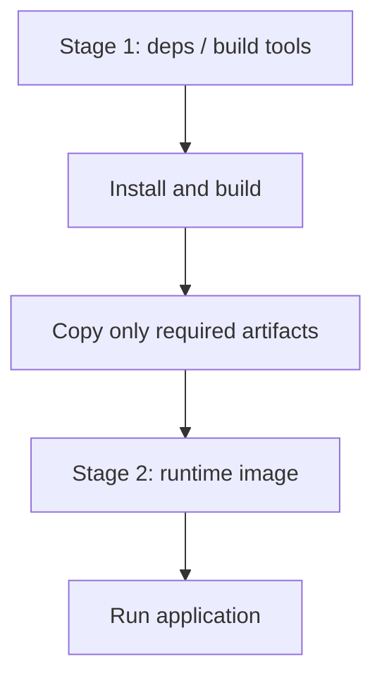
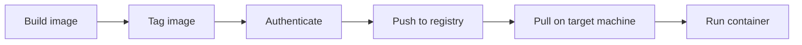

# DEV-006 — Multi-stage Builds, Image Optimization & Registries

> Multi-stage builds separate build-time work from the final runtime image; registries make versioned images available to other machines and deployment systems.

## 1. Why optimize container images?

A Docker image should contain the runtime and files needed to execute the application, not every tool used during development. Keeping unnecessary dependencies and build tools out of the final image can reduce its size, transfer time, and attack surface.

The amount of optimization depends on the application. A small JavaScript API that already uses an Alpine base image may show only a modest size reduction. Multi-stage builds become more valuable when the build environment contains compilers, test tools, frontend toolchains, or other large dependencies.

## 2. Multi-stage build fundamentals

A multi-stage Dockerfile uses multiple `FROM` instructions. Each `FROM` starts a new build stage. A later stage can selectively copy artifacts from an earlier one with `COPY --from=<stage>`.



The final image is normally produced from the last stage. Files that exist only in an earlier stage are not automatically carried into the final image.

## 3. Node.js API example

For the lab's plain JavaScript Express application, there is no compilation step. The first stage installs production dependencies, and the final stage copies those dependencies and the required application files.

```dockerfile
# Stage 1: production dependencies
FROM node:22-alpine AS deps

WORKDIR /app

COPY package*.json ./
RUN npm ci --omit=dev

# Stage 2: runtime
FROM node:22-alpine AS runtime

WORKDIR /app
ENV NODE_ENV=production

COPY --from=deps --chown=node:node /app/node_modules ./node_modules
COPY --chown=node:node package.json server.js ./

USER node

EXPOSE 3000
CMD ["node", "server.js"]
```

Important instructions:
- `AS deps` names the first stage.
- `npm ci --omit=dev` installs dependencies from the lockfile while omitting development dependencies.
- `FROM node:22-alpine AS runtime` starts a fresh final stage.
- `COPY --from=deps` selectively copies the production `node_modules` directory.
- `--chown=node:node` gives the non-root runtime user ownership of copied files.
- `USER node` runs the application as the unprivileged Node user.
- `NODE_ENV=production` marks the runtime environment as production.

`npm ci` requires a lockfile such as `package-lock.json`. Keep secrets such as `.env` out of the build context with `.dockerignore`; do not copy credentials into an image.

## 4. Build and verify the application

Validate the Compose model and rebuild:

```powershell
docker compose config
docker compose up --build -d
docker compose ps
```

Test the API and database endpoint:

```powershell
curl.exe http://localhost:3000/
curl.exe http://localhost:3000/db
```

Expected lab responses included:
- `{"message":"Backend is running!"}`
- A successful PostgreSQL connection response with a timestamp.

## 5. Inspect the image

Find the backend image reference:

```powershell
$backendImage = docker compose images -q backend
```

Inspect its history:

```powershell
docker image history $backendImage
```

The history displays image layers and their build instructions. In the lab, the resulting history showed:
- A Node.js Alpine base image containing the largest layer.
- A production dependency copy layer of approximately 5.49 MB.
- An application files copy layer of approximately 16.4 KB.
- Runtime metadata instructions such as `ENV`, `USER`, `EXPOSE`, and `CMD`.

The lab's local image listing reported approximately 245 MB disk usage and 62.1 MB content size. These are different measurements and should not be treated as interchangeable.

## 6. Tags and image references

An image tag gives a human-readable name to a specific image reference. Tagging does not rebuild the image and does not create a separate copy of all its layers.

```powershell
docker tag $backendImage docker-real-app:lesson12
docker image ls docker-real-app
```

The lab verified the local tag `docker-real-app:lesson12`, with image ID beginning `796bb2c7a733`.

A registry-qualified image reference has this general form:

```text
[REGISTRY_HOST/]NAMESPACE/REPOSITORY:TAG
```

For Docker Hub, the lab used:

```text
wanderer404/docker-real-app:lesson12
```

The tag `lesson12` identifies the version label used in this exercise. In team and production workflows, choose a deliberate tagging strategy such as release versions or commit identifiers rather than relying only on the mutable `latest` tag.

## 7. Container registries

A container registry stores and distributes container images. A typical workflow is:



The lab used Docker Hub and a private repository named `wanderer404/docker-real-app`.

Authenticate interactively:

```powershell
docker login
```

Tag the image with the Docker Hub namespace:

```powershell
docker tag docker-real-app:lesson12 wanderer404/docker-real-app:lesson12
```

Push it:

```powershell
docker push wanderer404/docker-real-app:lesson12
```

The Docker Hub repository page confirmed that the `lesson12` image tag had been pushed. The screenshot showed the repository as private and reported a repository size of approximately 59.3 MB. Registry storage size can differ from local Docker disk-usage figures because these are different measurements.

Never put Docker Hub passwords or personal access tokens in source code, a Dockerfile, or chat. Use interactive login or a securely managed credential mechanism.

## 8. Pulling and verifying an image

A target machine retrieves the published image with:

```powershell
docker login
docker pull wanderer404/docker-real-app:lesson12
```

For a private repository, the target machine must authenticate with an account that has permission to pull the image.

Inspect the pulled image:

```powershell
docker image inspect wanderer404/docker-real-app:lesson12 --format '{{.Id}}'
docker image ls wanderer404/docker-real-app
```

The local image ID can be compared with the original tagged image ID:

```powershell
docker image inspect docker-real-app:lesson12 --format '{{.Id}}'
```

Matching image IDs confirm that both references point to the same image content.

## 9. Key takeaways

- Multiple `FROM` instructions create separate build stages.
- `COPY --from` transfers only explicitly selected artifacts into a later stage.
- Production dependencies can be installed with `npm ci --omit=dev`.
- Run production processes as a non-root user where practical.
- `docker image history` helps inspect image build layers.
- A tag is a reference, not a rebuild or a full duplicate image.
- `docker push` publishes an image to a registry; `docker pull` retrieves it.
- Private registry images require authenticated access.
- Compare like-for-like image size measurements; local disk usage and registry size are not necessarily identical.

## 10. Practical checklist

- [x] Replace the original Dockerfile with a multi-stage version.
- [x] Build and start the Compose application.
- [x] Verify the API endpoint and PostgreSQL connection.
- [x] Inspect image history and runtime layers.
- [x] Create the local `docker-real-app:lesson12` tag.
- [x] Tag the image as `wanderer404/docker-real-app:lesson12`.
- [x] Push the image to the private Docker Hub repository.
- [ ] Pull the published tag and verify its image ID.

## 11. Knowledge check

1. What problem do multi-stage builds solve?
2. What does `COPY --from=deps` do?
3. Why is `npm ci --omit=dev` useful for a production-only dependency stage?
4. Does `docker tag` rebuild an image?
5. What is the difference between `docker push` and `docker pull`?
6. Why must a machine authenticate before pulling from a private repository?
7. Why might local Docker disk usage differ from the size shown in a registry UI?

## Related topics

- [[DEV-004 — Docker & Containerization]]
- [[DEV-005 — Docker Resource Limits, Restart Policies & Lifecycle]]
- [[DEV-007 — Production Deployment Foundations]]
- [[Kubernetes]]
