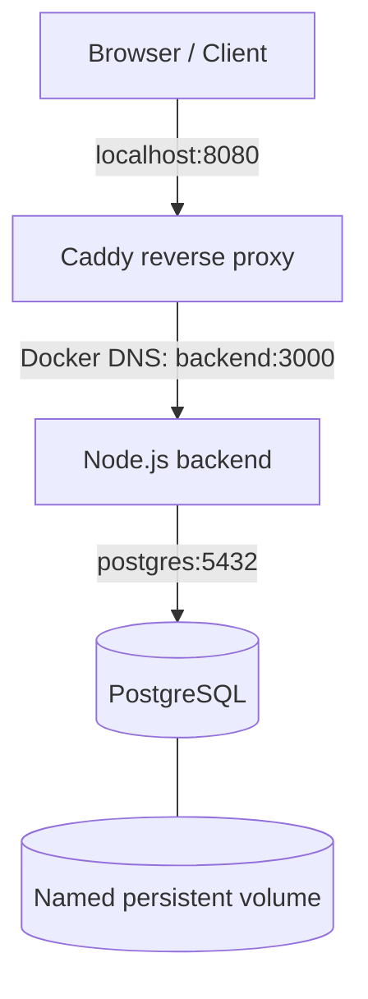
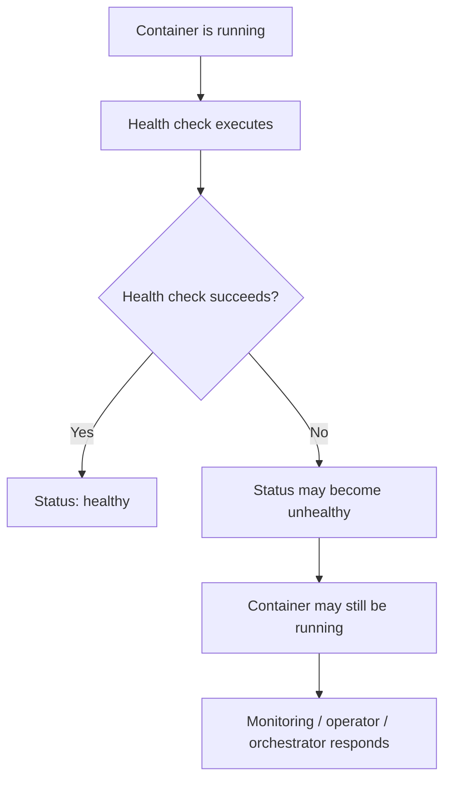

# DEV-007 — Production Deployment Foundations

> Production deployment requires controlled public access, private service networking, protected credentials, persistent data, observability, and tested recovery.

## 1. Development vs production

Development Compose setups commonly build from local source and publish service ports for debugging. Production-like setups should use a known image version, minimize host-published ports, define persistent storage, manage credentials deliberately, and configure logging and health checks.

| Concern | Development | Production-like lab |
|---|---|---|
| Backend image | Local build | Versioned registry image |
| Public entry point | Direct backend port | Reverse proxy |
| Database port | May be published for debugging | Internal network only |
| Configuration | Local .env | Production configuration and managed secrets |
| Database data | Named volume | Persistent volume plus tested backups |
| Logs | Console output | Bounded/rotated logs and collection |
| Recovery | Manual intervention | Restart policy plus monitoring |

## 2. Production-like architecture

The lab used Caddy as a reverse proxy in front of the Node.js backend. PostgreSQL remained private on the Compose network.



Only Caddy published a host port. The backend and PostgreSQL used internal Compose networking.

## 3. Reverse proxy

The lab Caddyfile was:

```caddyfile
:80 {
    reverse_proxy backend:3000
}
```

Caddy receives the client request and forwards it to the backend using Docker Compose service-name DNS.

A reverse proxy forwards requests internally. This is different from an HTTP redirect, where the server sends a 3xx response instructing the browser to make another request.

The lab exposed Caddy on host port 8080 and used HTTP for local testing. It was not a publicly accessible HTTPS production deployment.

For a real deployment with a domain and reachable server:

```caddyfile
app.example.com {
    reverse_proxy backend:3000
}
```

A real deployment also needs DNS pointed at the server, inbound access to ports 80 and 443, and persistent Caddy data/configuration.

## 4. Separate production Compose configuration

A separate `compose.production.yaml` can use the pushed image instead of building local source.

Key patterns:

```yaml
services:
  backend:
    image: wanderer404/docker-real-app:lesson12
    expose:
      - "3000"
    restart: unless-stopped
    depends_on:
      postgres:
        condition: service_healthy

  postgres:
    image: postgres:18-alpine
    expose:
      - "5432"
    volumes:
      - postgres-data:/var/lib/postgresql

  proxy:
    image: caddy:2-alpine
    ports:
      - "8080:80"
```

The complete lab configuration also included resource limits, health checks, the Caddyfile bind mount, Caddy data/config volumes, and log rotation.

Important distinction:
- `ports` publishes a container port on the host.
- `expose` makes a service port available for other services on the Compose network without publishing it on the host.
- Services on the same network can use service-name DNS.

## 5. Health checks vs restart policies

A health check reports whether a service is healthy. A restart policy controls what Docker does when a container exits.

An `unhealthy` status alone does not cause Docker's `restart: unless-stopped` policy to restart the container.



A basic HTTP endpoint check does not necessarily prove every dependency is healthy. Define health checks around the property you actually need to monitor.

## 6. Logging and rotation

The lab used Docker's `local` logging driver with bounded size and retention:

```yaml
logging:
  driver: local
  options:
    max-size: "10m"
    max-file: "3"
```

Rotation prevents unbounded local container logs from consuming the host's disk. Larger deployments should also collect logs centrally and apply retention and access controls.

## 7. Secrets: configuration is not secret storage

A local `.env` file is convenient for development, but it is not a secrets manager. Environment variables can be exposed to processes and inspection/debugging paths, and plaintext files can be committed or copied accidentally.

Compose secrets are mounted as files under `/run/secrets/<secret_name>` and are granted to services explicitly. The application must be written to read a secret file (or support a matching `*_FILE` setting); declaring a secret does not automatically make the application consume it.

Example:

```yaml
services:
  backend:
    secrets:
      - db_password

secrets:
  db_password:
    file: ./secrets/db_password.txt
```

Protect the source file with filesystem permissions and `.gitignore`. For real production, prefer a securely managed secret store with access control, rotation, and audit capabilities. Never put secrets in Dockerfiles, image layers, Git commits, or chat.

## 8. Database persistence and backups

A named volume stores PostgreSQL's live data files and survives ordinary container replacement. It is not a backup.

The lab created a PostgreSQL logical backup using custom archive format:

```powershell
New-Item -ItemType Directory -Force .\backups
docker compose -f compose.production.yaml exec -T postgres pg_dump -U appuser -d appdb -Fc -f /tmp/appdb.dump
docker compose -f compose.production.yaml cp postgres:/tmp/appdb.dump .\backups\appdb.dump
```

This creates a database-level backup file that can be stored separately from the running database. A reliable backup plan includes a schedule, retention, off-host storage, encryption/access control, monitoring, and regular restore tests.

Do not assume a backup is valid until a restore has been tested. Avoid destructive restore options against a database you still need.

## 9. Validation and operations

Validate and start the production-like Compose project:

```powershell
docker compose -f compose.production.yaml config
docker compose -f compose.production.yaml up -d
docker compose -f compose.production.yaml ps
```

Test traffic through the proxy:

```powershell
curl.exe http://localhost:8080/
curl.exe http://localhost:8080/db
```

Inspect logs:

```powershell
docker compose -f compose.production.yaml logs -f proxy
docker compose -f compose.production.yaml logs backend
docker compose -f compose.production.yaml logs postgres
```

## 10. Key takeaways

- Expose only the intended public entry point.
- A reverse proxy forwards requests; it is not necessarily an HTTP redirect.
- A named volume provides persistence, not backup.
- `.env` is configuration convenience, not secure secret management.
- Health status and container process state are distinct.
- Restart policies react to container exits, not simply to an unhealthy status.
- Log rotation protects local disk capacity; central collection is a separate operational concern.
- A local production-like Compose lab is not the same as a hardened public production deployment.

## 11. Knowledge check

1. Why should PostgreSQL remain off the public host interface?
2. How is reverse proxying different from an HTTP redirect?
3. Why isn't a named volume a backup?
4. What risks can a plaintext .env file introduce?
5. Does unhealthy automatically trigger restart: unless-stopped?
6. Why rotate container logs?
7. Why separate development and production Compose configuration?

## Related topics

- [[DEV-006 — Multi-stage Builds, Image Optimization & Registries]]
- [[DEV-008 — Docker Swarm Core Concepts]]
- [[Kubernetes Health Probes]]
- [[Database Backup and Recovery]]
