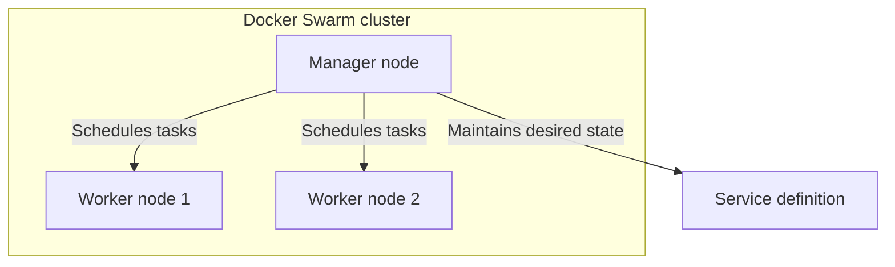
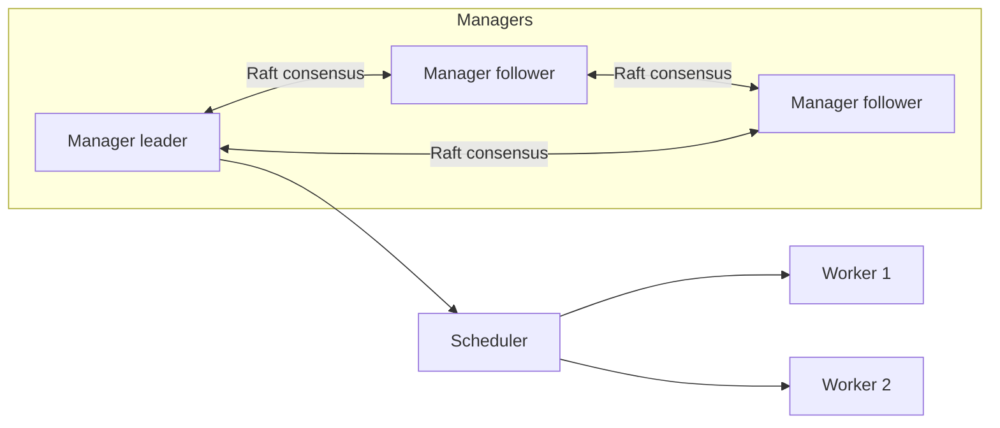
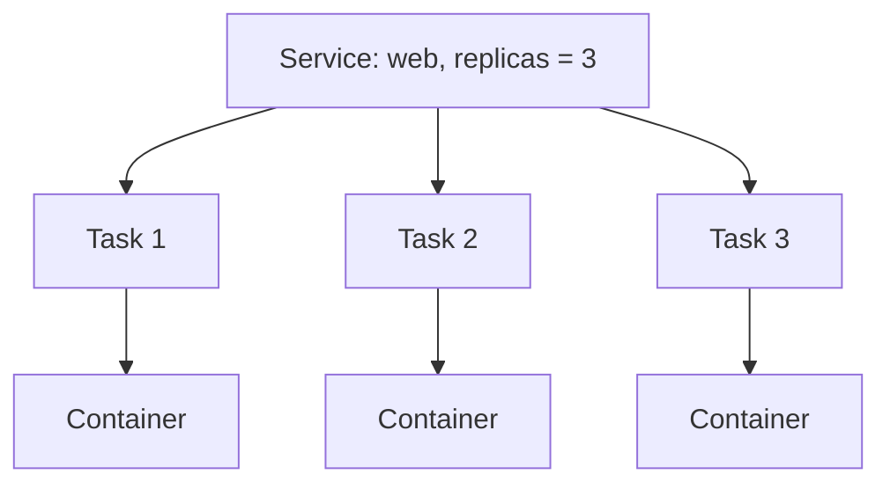
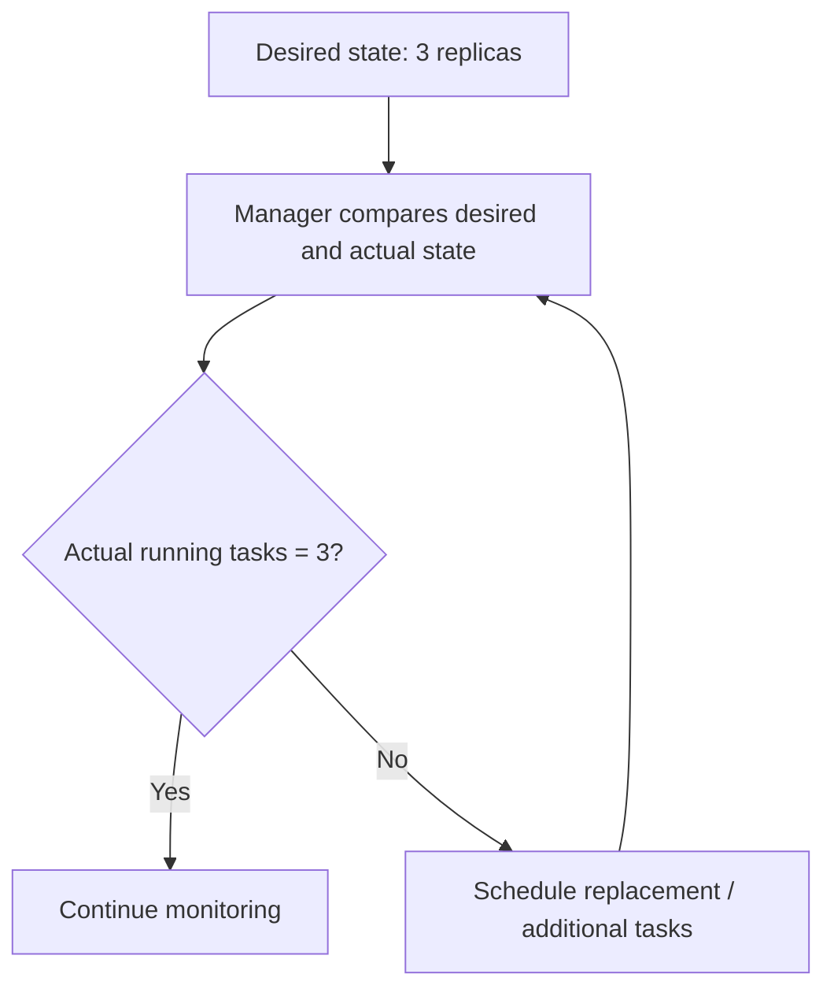

# DEV-008 — Docker Swarm Core Concepts

> Docker Swarm mode turns multiple Docker Engine hosts into a cluster that can deploy services and continuously reconcile them toward a declared desired state.

## 1. Why orchestration?

Running `docker run` or Docker Compose on one machine is useful, but the operator remains responsible for deciding where workloads run and what to do when a host disappears.

An orchestrator accepts a description of the intended application state and coordinates containers across a group of machines. Docker Swarm mode is built into Docker Engine and provides cluster management and service orchestration.

A swarm can contain one or more Docker Engine hosts. Each host participating in the swarm is a node.

## 2. Nodes: managers and workers

### Manager nodes

Managers handle cluster-management responsibilities:
- Maintain cluster state.
- Schedule service tasks.
- Serve the Swarm management API.
- Maintain a consistent internal state using Raft consensus among managers.

One manager is elected leader for orchestration decisions. Other managers can be followers and participate in the consensus group.

### Worker nodes

Workers execute tasks assigned by managers. A worker agent reports task state back to the manager.

By default, manager nodes can also run service tasks. A manager can be configured with availability `drain` to prevent ordinary workload tasks from being scheduled there.

For production high availability, manager count and placement should be designed around quorum. An odd number of managers is commonly recommended. A single-manager swarm is fine for learning but has no manager fault tolerance.

## 3. Nodes, services, tasks, and containers

These terms are not interchangeable.

| Concept | Meaning |
|---|---|
| Node | A Docker Engine host participating in the swarm. |
| Service | The desired definition of a workload: image, command, replicas, network, published ports, resources and update policy. |
| Task | A scheduled unit of work for a service on a particular node. It is the atomic scheduling unit. |
| Container | The runtime instance created to execute a task. |

A task is associated with one container execution. If a task fails or its node becomes unavailable, the manager can schedule a replacement task to restore the desired replica count.

## 4. Desired state and reconciliation

When you declare a service with three replicas, you are declaring that the service should have three running task replicas, not merely asking Docker to start three containers once.

If a worker hosting one task becomes unavailable, the manager attempts to schedule a replacement on an available node. Replacement requires sufficient resources and a usable image, network and storage configuration.

## 5. Replicated vs global services

- **Replicated service:** runs a specified number of task replicas across available nodes.
- **Global service:** runs one task on each eligible node.

Examples:
- Replicated: a web API with three replicas.
- Global: a node-level monitoring agent that should run on each eligible node.

## 6. Docker Swarm vs Docker Compose

| Compose | Swarm |
|---|---|
| Defines multi-container application services, commonly on one Docker host/project | Orchestrates services across a swarm cluster |
| Uses `docker compose up` | Uses `docker service` or `docker stack deploy` |
| Compose manages containers through the local Engine | Managers schedule tasks onto swarm nodes |
| Project networks are commonly bridge networks | Multi-host service connectivity uses overlay networks |
| Does not provide cluster-wide desired-state scheduling by itself | Reconciles service tasks toward desired state |

Compose remains useful for local development. Swarm is a separate deployment/orchestration mode.

## 7. Swarm control-plane and data-plane ports

For multi-host Swarm communication, Docker documents these default ports:

| Port | Protocol | Purpose |
|---|---|---|
| 2377 | TCP | Swarm management/control plane |
| 7946 | TCP and UDP | Node communication and network discovery |
| 4789 | UDP | Overlay network data path (VXLAN) |

Allow these only between trusted swarm hosts/firewalls as required. Do not expose Swarm management ports to the public internet.

## 8. What comes next

The next hands-on chapter will:
1. Inspect whether the local Docker Engine is already in Swarm mode.
2. Initialize a single-node swarm on the Docker Desktop engine.
3. Inspect the manager node.
4. Create a small replicated service from the published Docker Hub image.
5. Scale the service and observe task placement and desired-state reconciliation.

A single-node swarm teaches the CLI and service model, but it does not demonstrate multi-host scheduling or host-failure tolerance. For that, use multiple Docker Engines on separate VMs or physical/cloud hosts.

## 9. Key takeaways

- Swarm mode is built into Docker Engine.
- A node is a participating Docker Engine host.
- Managers maintain cluster state and schedule tasks; workers execute assigned tasks.
- A service defines desired workload state; tasks are scheduled executions; containers run tasks.
- The manager continuously tries to reconcile actual state with desired state.
- Replicated services run a set number of task replicas; global services run one task per eligible node.
- A single manager is suitable for learning but not manager high availability.
- Swarm is not a prerequisite for Kubernetes; it is a useful way to learn orchestration concepts.

## 10. Knowledge check

1. What is a Swarm node?
2. What responsibilities belong to a manager?
3. What is the difference between a service and a task?
4. What does desired state mean?
5. How do replicated and global services differ?
6. Why does a single-manager swarm lack manager fault tolerance?
7. Why doesn't a single-node swarm prove multi-host scheduling works?

## Related topics

- [[DEV-007 — Production Deployment Foundations]]
- [[DEV-009 — Swarm Initialization and Service Scheduling]]
- [[Docker Compose]]
- [[Kubernetes]]
