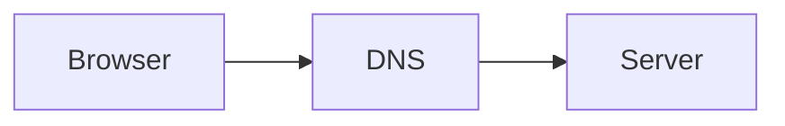

# Learning Template

Version: 2.0

Status: Active

---

# Purpose

This document defines the standard format for every learning note inside Cyber Atlas.

Every topic must follow this template to ensure consistency across the entire knowledge graph.

Topics should be understandable independently while remaining connected to related concepts.

## Folder layout

For a multi-part topic, place this frontmatter in the topic folder's `README.md`. Add numbered chapter files such as `01-History.md` and `02-Resolution.md` beside it. The `README.md` is the single graph node; chapter files are rendered inside its topic page and do not need their own graph IDs.

---

# Learning Philosophy

Every note answers six questions.

1. Why was it invented?

2. What problem did it solve?

3. How does it work internally?

4. How is it implemented?

5. How is it used in production?

6. How is it debugged?

If a note does not answer these questions, it is incomplete.

---

# Standard Frontmatter

```yaml
---
id: NET-001

title: Domain Name System (DNS)

category: networking

status: completed

difficulty: 2

mastery: learning

summary: Converts domain names into IP addresses.

estimated_time:
  theory: 60
  practical: 45
  homework: 30

tags:
  - networking
  - dns

prerequisites:
  - CS-001

unlocks:
  - NET-002

connections:

  - id: NET-002
    relationship: enables

used_in:

  - AWS Route53

  - Kubernetes CoreDNS

projects:

  - Cyber Atlas

references:

  - RFC1035

last_updated:

version: 1.0
---
```

---

# Document Structure

Every note follows this exact order.

```
Summary

History

Problem

Evolution

Core Concepts

Internal Working

Architecture Diagram

Real World Flow

Implementation

Commands

Configuration Files

Practical Lab

Debugging

Production Usage

War Stories

Performance

Security

Interview Questions

Homework

Knowledge Check

References

Related Topics

Next Topic
```

---

# Section Standards

## Summary

Maximum

10 lines.

Explain what the technology does.

No history.

No implementation.

---

## History

Explain

- when
- where
- who
- why

Include timeline diagrams whenever possible.

---

## Problem

Describe the engineering problem that forced this technology to exist.

Avoid definitions.

Focus on pain points.

---

## Evolution

Show previous technology

↓

limitations

↓

new technology

Always use timeline diagrams.

---

## Core Concepts

Explain terminology.

Definitions belong here.

---

## Internal Working

The deepest section.

Explain

- architecture
- algorithms
- protocols
- kernel interaction
- networking
- memory
- scheduling

depending on topic.

---

## Architecture Diagram

Every note must contain at least one architecture diagram.

Prefer Mermaid.

Example



---

## Real World Flow

Explain how companies use the technology.

Prefer

Google

Netflix

Cloudflare

AWS

GitHub

Linux

Kubernetes

---

## Implementation

Show practical implementation.

Prefer

production-inspired

examples.

---

## Commands

Every command must include

Purpose

Syntax

Explanation

Expected Output

Common Mistakes

Never provide unexplained commands.

---

## Configuration Files

Explain

- syntax
- location
- usage

Show real examples.

---

## Practical Lab

Every note must contain at least one practical exercise.

Structure

Goal

Environment

Commands

Expected Result

Verification

Cleanup

---

## Debugging

Explain

Symptoms

Causes

Diagnosis

Tools

Solutions

---

## Production Usage

Explain how this technology appears inside real production systems.

---

## War Stories

Whenever possible

include real engineering incidents.

Examples

Facebook DNS outage

GitHub outage

Cloudflare incident

Kubernetes failures

AWS outages

---

## Performance

Explain

bottlenecks

optimizations

trade-offs

---

## Security

Explain

common attacks

misconfigurations

best practices

---

## Interview Questions

Include

beginner

intermediate

advanced

questions.

---

## Homework

Homework should include

reading

commands

implementation

thinking questions

challenge

---

## Knowledge Check

Short self-evaluation.

Should verify conceptual understanding.

---

## References

Use

RFCs

Official documentation

Academic papers

Books

Avoid random blogs whenever possible.

---

## Related Topics

Use Obsidian links.

Example

```
[[TCP]]

[[HTTP]]

[[Linux]]
```

---

## Next Topic

Always point to the next logical topic.

Learning should remain chronological.

---

# Diagram Standards

Preferred order

1 Flowchart

2 Sequence Diagram

3 Timeline

4 Architecture

5 State Diagram

6 ER Diagram

7 Mind Map

---

# Mermaid Standards

Always prefer Mermaid.

Use Draw.io only when Mermaid becomes unreadable.

---

# Difficulty Levels

1 Beginner

2 Basic

3 Intermediate

4 Advanced

5 Expert

---

# Practical Levels

Every topic should eventually contain

Level 1

Observe

Level 2

Implement

Level 3

Debug

Level 4

Break

Level 5

Build

---

# Completion Criteria

A topic is considered completed only if

✅ Theory understood

✅ Commands executed

✅ Lab completed

✅ Homework completed

✅ Knowledge Check passed

---

# Writing Style

Professional.

Technical.

Explain the "why" before the "how."

Avoid unnecessary repetition.

Prefer real engineering examples.

Avoid textbook definitions.

---

# Final Principle

Cyber Atlas is intended to become a long-term engineering encyclopedia.

Optimize every note for future understanding rather than short-term memorization.
